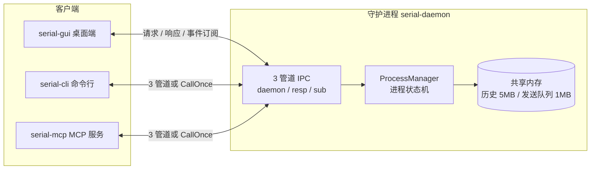

<div align="center">

# serial-debugger

**一个工具覆盖串口调试全流程** — 扫描与连接 · 文本 / Hex 收发 · 定时自动发送 · 端口转发 · 设备探测 · 多标签 · 历史持久化

**GUI · CLI · MCP 三个客户端，共用一个守护进程**

[](https://github.com/nienieai/serial-debugger/releases)
[](CHANGELOG.md)
[](LICENSE)
[](https://github.com/nienieai/serial-debugger/actions/workflows/release.yml)

[](https://go.dev)
[](https://wails.io)


[](CLI-CHEATSHEET.md)
[](ARCHITECTURE.md)
[](config/i18n)

</div>

---

## ✨ 特性 / Features

- 🧭 **一套引擎，三个入口** —— GUI（Wails 桌面端）、CLI（交互 REPL + 一次性命令）、MCP（JSON-RPC over stdio）连接同一个守护进程，串口只开一次，谁都能看能发。
- 🔌 **串口全流程** —— 扫描/刷新、文本与 Hex 双模收发、流控（None / RTS-CTS / XON-XOFF）、连接中直接换端口、进程生命周期（idle ↔ connected）显式管理。
- 🧵 **多标签独立会话** —— 每个标签页有自己的端口、缓冲、历史与滚动位置；设置页独立成页，不占会话。
- 🗂️ **历史不丢也不卡** —— 共享内存环形缓冲 5 MB/进程 + 磁盘双写；读满不冻结（挤掉最旧的包）；`limit`/`beforeTsMs`/`sameTsSkip` 分页，界面按 5000 条回补，往回翻可回看约 4 万条。
- ⏱️ **自动发送引擎** —— 单条定频 + 多条目队列两种模式，运行中可改进度；`delay` 支持 0（连发）到 60000 ms 逐条设定。
- 🔁 **端口转发** —— 双串口双向透传，P1/P2 方向独立显示与统计，PC 端作为旁路监听。
- 🔎 **设备探测** —— TOML 规则驱动，substring / regex / modbus_crc 三种匹配，按可能性排序扫波特率、带总预算、跳过已占用端口，`busy` 与用过哪几档波特率都显式返回。
- 🎨 **可换肤** —— 颜色主题（dark/light 双模式、CSS 全变量化、`resources/themes/<id>/` 主题文件夹（素材随主题走））+ 图标主题（`resources/icons/<包名>/`）+ 数据高亮自定义（单端口 10 项 / 转发 9 项，含 EyeDropper 取色）。
- 🌏 **9 种语言** —— zh / zh-Hant / en / ja / ko / fr / es / ru / ar（含 RTL），支持外部 i18n 文件覆盖。

## 🚀 快速开始 / Quick Start

> 📦 **下载**：见 [Releases](https://github.com/nienieai/serial-debugger/releases)（推送 `v*` tag 或手动触发 Actions 即产出，解压即用；Windows 需已安装 WebView2 Runtime）。

> ⚠️ **使用须知**
> - **安全**：本工具当前无安全相关设计（无认证、加密、访问控制等），仅限在受信任的本地环境使用，请勿用于安全敏感场景——详见[安全说明](#安全说明)。
> - **翻译**：界面多语言由 AI 辅助翻译，可能存在不准确之处，欢迎提交修正——详见[国际化](#国际化)。

### GUI

1. 启动 `serial-gui.exe`（自动拉起守护进程）。
2. 点击「扫描」选择目标串口（如 `COM3`），设置波特率等参数，点击「打开」。
3. 在发送区输入数据，切换文本 / Hex 模式后点击「发送」；接收区实时回显。

### CLI

```bash
serial-cli start                # 启动守护进程
serial-cli ports                # 列出可用串口
serial-cli open COM3 115200     # 打开串口
serial-cli send "AT\r\n"        # 发送文本
serial-cli status               # 查看守护进程状态
serial-cli shutdown             # 关闭守护进程
```

> 不带参数进入交互 REPL，输入 `help` 查看全部命令；完整命令速查见 [CLI 速查表](CLI-CHEATSHEET.md)。

### MCP

`serial-mcp.exe` 作为 MCP 服务端通过 stdio 提供 JSON-RPC 2.0 接口，可接入支持 MCP 协议的客户端。

## 🧩 组成 / Components

| 可执行文件 | 说明 |
| --- | --- |
| `serial-daemon.exe` | 守护进程，单实例（互斥体），ProcessManager 管理 idle/connected 双状态 + single/forward 双模式 |
| `serial-gui.exe` | Wails v2 桌面客户端，多标签页，3 管道持久连接，纯事件驱动 |
| `serial-cli.exe` | 命令行工具，交互 REPL + 一次性命令，34 条命令（含 help） |
| `serial-mcp.exe` | MCP 协议工具，JSON-RPC 2.0 over stdio，28 个工具 |

## ⚡ 架构 / Architecture



**架构亮点**

- **3 管道 IPC + 共享内存**：daemon/resp/sub 命名管道承载控制与事件订阅；共享内存环形缓冲区承载数据（历史 5 MB/进程、发送队列 1 MB/进程），发送走共享内存、IPC 仅触发。
- **守护进程 + 多客户端**：GUI / CLI / MCP 统一接入同一守护进程，ProcessManager 管理 idle/connected 状态与 single/forward 模式；心跳 5 s 一次，连续 3 次失败判定断连。
- **解码引擎 Go 化**：Go 端 per-tab goroutine 逐字节容错解码，产出 `[]Segment` 分段结构；前端纯 DOM 渲染（零 `innerHTML`），解码与渲染彻底解耦。

> 数据走共享内存（发送队列），IPC 承载控制与事件。历史上曾规划「客户端直接映射共享内存读取历史」，但该路径**从未接通**（`ringbuf.OpenSharedRing` 无调用点，且它只映射只读视图、返回对象上的读操作会写 tail，按原设计调用会崩），历史读取实际全部走 IPC 的 `session.history`。详见「已知限制」。

## 🔧 功能细节 / Details

### 串口核心

- 进程生命周期管理：idle ↔ connected 状态机，端口双向映射去重，显式销毁，断连保留
- 双模显示/发送（文本/Hex），独立缓冲区，单键切换
- 串口切换：连接中直接切换到其他端口，保留进程和历史
- 端口转发：绑定双串口双向透传，方向以 P1/P2 独立显示和统计
- 设备端口探测：TOML 规则配置，3 种匹配模式（substring / regex / modbus_crc），自动跳过已连接端口
- 流控支持：None / RTS/CTS / XON/XOFF

### 数据路径

- 发送走共享内存（1 MB/进程），IPC 仅触发
- 守护进程内置自动发送引擎：单条模式 + 多条目队列模式，运行中可修改
- 共享内存环形缓冲区（5 MB/进程），历史读取经 IPC 的 `session.history`（`Snapshot` 语义，读不消费；带 `limit`/`beforeTsMs`/`sameTsSkip` 可分页取，界面默认只取最新一页、往上翻时按 5000 条回补）
- 历史持久化双写：环形缓冲区 + 磁盘文件同步追加
- 环形缓冲区写满时挤掉最旧的包（保留最新的一段），不会停止记录

### 事件系统

- 订阅式推送：`rx` / `tx` / `1` / `2` / `send-error` / `ports-changed` / `process-changed` / `daemon-shutdown` / `stats-count` / `stats-rate` / `clients-changed` / `multistr-changed`
- 统计拆分：count（变化推送）+ rate（每秒推送），速率 ≥80% 橙色、≥90% 红色
- 订阅后立即推送当前状态

### 主题与外观

- **颜色主题**：文件驱动 + `_modes` 声明（dark/light 双模式），三段式色值（common/dark/light），CSS 全变量化，外部主题自动发现
- **图标主题**：内置 `config/resources/icons/system/`（20 个 SVG），外部 `resources/icons/<包名>/` 文件夹格式，`_fallback` 回退
- **数据高亮自定义**：单端口 10 项 + 端口转发 9 项独立颜色设置，深浅色独立/统一，集成调色板（RGBA 滑块 + EyeDropper + 预设色板）
- **响应式设置页**：800 px 断点，宽屏左右分栏，窄屏导航悬浮覆盖层；搜索框内嵌图标
- **模糊渐变条**：config-bar / send-controls / settings-header / 转发按键栏统一透明 + 渐变模糊

### 前端架构

- 纯组件化标签页，`index.html` 仅保留 4 个结构元素，其余 JS 动态构建
- TabPage 独立 DOM 子树 + show/hide/destroy 生命周期，per-tab 完整状态
- 设置页独立标签页，侧边栏导航 + 气泡卡片布局
- Go 端 per-tab goroutine 解码，产 `[]Segment` 分段结构；JS `renderSegments()` 纯 DOM 渲染，零 `innerHTML`
- 空格和 CR/LF 可视化为标记（`·` / `←` / `↵`），`user-select: none` 保证剪贴板原样拷贝
- CSS 架构分层：`o-` 布局 / `c-` 组件 / `t-` 皮肤 / `is-` 状态

### 国际化

- 9 种语言（zh / en / ja / zh-Hant / ko / ar / ru / fr / es），含阿拉伯语 RTL
- 外部 i18n 文件覆盖内置翻译，`_font` 字段绑定语言首选字体

> **翻译说明**：多语言翻译由 AI 辅助生成，可能存在不准确、遗漏或语境偏差，欢迎提交修正（内置文件见 `config/resources/i18n/`，外部覆盖见下方「配置」表）。

### 连接管理

- 双层断连检测：管道断裂即时检测 + 心跳兜底（5 s ping，连续 3 次失败判定断连）
- 状态栏三色气泡实时显示 GUI/CLI/MCP 连接数
- JS 侧 `_connecting` 互斥防重连风暴，Go 侧锁区合并 + 身份校验

## 📦 安装与构建 / Build

### 下载

获取对应平台的构建产物压缩包，解压即用。Windows 需系统已安装 WebView2 Runtime。

### 从源码构建

```bash
# 在仓库根目录执行
go build -ldflags="-s -w" -o build/bin/serial-daemon.exe ./daemon/
go build -ldflags="-s -w" -o build/bin/serial-cli.exe    ./cmd/serial-cli/
go build -ldflags="-s -w" -o build/bin/serial-mcp.exe    ./cmd/serial-mcp/
wails build -devtools  # GUI，产物在 build/bin/
```

> 💡 **仅需命令行工具时**（无需 GUI），可直接用 `go install` 安装：
>
> ```bash
> go install github.com/nienieai/serial-debugger/cmd/serial-cli@latest
> go install github.com/nienieai/serial-debugger/cmd/serial-mcp@latest
> go install github.com/nienieai/serial-debugger/daemon@latest
> ```
>
> GUI（`serial-gui`）需 Wails 环境（`wails build`），完整构建矩阵见 [BUILD.md](BUILD.md)。

版本号统一维护在 `version/version.go`，改一处全部可执行文件同步。仓库已配置 [GitHub Actions 自动构建](.github/workflows/release.yml)：推送 `v*` 标签或手动触发即可产出二进制并发布 Release。

## 🖥️ CLI 命令 / CLI（34 条，含 help）

| 类别 | 命令 |
| --- | --- |
| 守护进程 | `start` `check` `status` `shutdown` |
| 端口 | `ports` `refresh` `probe [ports...] [--config]` |
| 进程 | `create` `declare` `open` `connect` `disconnect` `close` `switch` `setmode` `forward` |
| 数据 | `send [--hex]` `stats` `history` |
| 自动发送 | `autosend start/stop/status/interval` `sendqueue` |
| 多字符串 | `multistr save/load/reload/status` |
| 历史 | `history-files` `history-search` `history-enable` `history-status` `history-attach` `history-new` `history-detach` |
| 诊断 | `sessions` `monitor` `threads` `goroutines` |
| 其他 | `help` |

## 🤖 MCP 工具 / MCP（28 个）

`serial_start_daemon` `serial_list_ports` `serial_refresh_ports` `serial_create` `serial_open` `serial_connect` `serial_disconnect` `serial_switch` `serial_forward_create` `serial_declare` `serial_set_mode` `serial_close` `serial_send` `serial_sessions` `serial_history` `serial_status` `serial_monitor` `serial_shutdown` `serial_stats` `serial_port_watch` `serial_autosend_start` `serial_autosend_stop` `serial_autosend_status` `serial_sendqueue` `serial_multistr_save` `serial_multistr_load` `serial_multistr_status` `serial_probe_ports`

## ⚙️ 配置 / Config

| 位置 | 说明 |
| --- | --- |
| `config/probe.toml` | 设备探测规则（substring / regex / modbus_crc） |
| `config/resources/themes/<id>/theme.json` | 内置颜色主题（一个主题一个文件夹，`_modes` 声明模式） |
| `resources/themes/<id>/` | 外部颜色主题（与 exe 同目录，自带背景图等素材；刷新时自动发现） |
| `config/resources/icons/system/` | 内置图标包（27 个 SVG + `icons.json`） |
| `resources/icons/<包名>/` | 外部图标包（文件夹 = 包，缺的键回退 `system`） |
| `config/resources/i18n/` | 内置翻译（9 语言） |
| `resources/i18n/<lang>.json` | 覆盖内置翻译，`_font` 字段绑定语言首选字体 |

## 📚 文档 / Docs

| 文档 | 说明 |
| --- | --- |
| [框架文档](ARCHITECTURE.md) | 架构设计、IPC 协议、进程生命周期、时序图 |
| [需求文档](REQUIREMENTS.md) | 需求列表与实现状态 |
| [构建文档](BUILD.md) | 环境要求、构建矩阵、产物说明 |
| [待办与已知问题](TODO.md) | 待实现功能、已知问题、版本完成记录 |
| [版本历史](CHANGELOG.md) | 0.1.0 ～ 0.8.2 各版本的变更、根因与验收方法 |
| [布局规则](LAYOUT-RULES.md) | 前端布局与 CSS 约束 |
| [贡献指南](CONTRIBUTING.md) | 提交规范、翻译贡献、行为准则 |
| [第三方许可](THIRD_PARTY_NOTICES.md) | 依赖许可证清单（MIT/BSD/Apache/ISC） |
| [CLI 速查表](CLI-CHEATSHEET.md) | 常用命令速查与示例 |

## 📜 版本历史 / Changelog

当前版本 **v0.8.2**。最近三版：

| 版本 | 要点 |
|------|------|
| **0.8.2** | 资源统一到 `resources/` 并分「内置 / 外置」两层；主题支持图片（全页背景、四条栏、缩略图）；设置页外观卡与新建会话页重画；标签栏与多字符串面板拖动换成 pointer 实现（实时补位、FLIP 动画、边缘自动滚动、推挤「+」） |
| **0.8.1** | GUI 一轮集中修复：新建页先选模式、前端热重载、端口下拉同步与占用高亮、历史视图空白、自绘滚动条、状态栏统计残留、标签栏滚动提示、主题按钮图标 |
| **0.8.0** | 把 0.7.5.1 ～ 0.7.5.10 的修复整体收口为稳定基线；不含功能改动（源码与 0.7.5.10 的差别只有版本号） |
| **0.7.5.10** | 补 `serial-cli sendone [processId] [--raw]`，让「多字符串条目剥头」那条修复可黑盒验收 |

完整历史（0.1.0 起，含每个版本的根因分析、实测数据与验收方法）见 [`CHANGELOG.md`](CHANGELOG.md)。

<a id="安全说明"></a>

## ⚠️ 安全说明 / Security

> **本工具当前无安全相关设计**：不包含认证、授权、加密、访问控制或审计日志等安全机制；串口收发内容与历史记录以明文形式处理与存储。仅限在受信任的本地环境使用，请勿在不可信网络或安全敏感场景中部署。

## 🤝 贡献与许可 / Contributing

- 本项目基于 [MIT License](LICENSE) 开源，欢迎社区贡献——见 [贡献指南](CONTRIBUTING.md)。
- 👋 如果它帮到了您，欢迎 **Star**；遇到问题请提交 **Issue**，有改进想法欢迎 **Pull Request**。
- **AI 辅助声明**：本项目在开发与文档维护过程中使用了 AI Agent 工具辅助（代码生成与审计、文档润色、多语言翻译等）；文档与翻译内容由 AI 辅助产出，可能存在错误或不准确之处，欢迎指正与贡献修正。
