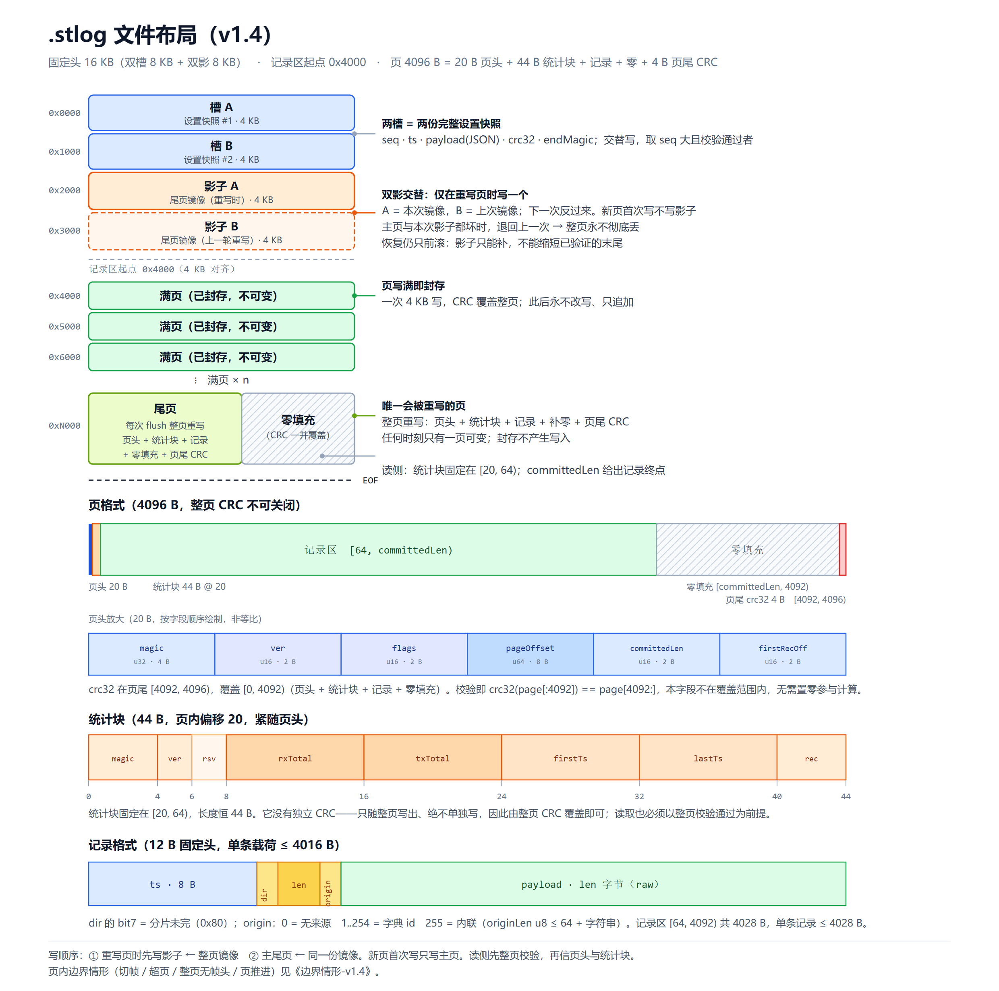
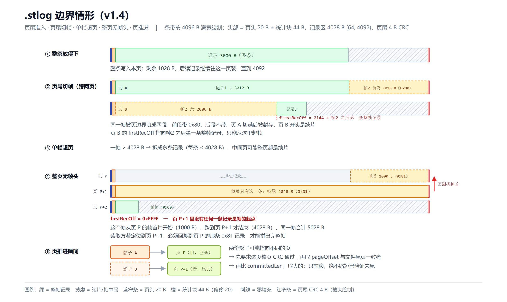

# 会话文件（.stlog）格式规范 v1.4

> 这是 `.stlog` 的**唯一正文**，实现与它不一致时以本文件为准（不一致本身就是 bug）。
> 版本演进见 [CHANGES.md](CHANGES.md)；本文件自身的历史用 `git log -- docs/format/stlog-format.md` 查。
> 多文件（manifest + 包 + 索引）的下一版方案见 [stlog-v2.md](stlog-v2.md)——**设计稿，未实现**。
> 布局图：[file-layout.png](file-layout.png)（[svg](file-layout.svg)）；边界情形：[boundary-cases.png](boundary-cases.png)（[svg](boundary-cases.svg)）。
>
> 目的：把"历史"从守护进程顺手写的日志，改成**每个开启了记录的标签/会话一个二进制文件**，
> 文件既是实时记录、也是恢复源；离线下 GUI 可只读打开，推送到守护进程后所有权整体移交。
>
> 状态：**核心已实现**（0.8.3，`sessionfile` 包 + daemon 录制 + CLI + GUI 只读标签页）；
> 未实现的是 §5 的 IPC 面、§9 的清理策略与 §12 的压测，见 §13 阶段表。
> v1.4 改的是**数据区的物理形态**，不是上层语义：连续追加改为 **4096 B 定长页**，
> 每页整页 CRC32、页头紧跟一个固定统计块、记录可被切分为跨页的分片、尾页由**两个交替的影子页**保护。
> 固定头由 8 KB 扩到 16 KB。逐条对照见 §16，被否掉的替代方案见 §17。

---

## 0. 目标 / 非目标

**目标**

1. 一个开启记录的标签/会话 = 一个 `.stlog` 文件；关闭记录保留文件，再开续写同一文件。
2. 离线（守护进程未运行）GUI 拖入文件即只读打开：分页、搜索、导出。
3. 推送是**手动**动作：把文件与会话设置的所有权移交给守护进程；之后 GUI 只经 IPC 操作。
4. 同一文件**写者唯一**；读者可并发（含杀毒/备份/我们自己的导出）。见 §3。
5. 导出 `log`（文本行）/ `txt`（解码文本）/ `csv`（结构化列）。
6. 新建会话支持「由文件开始（续写同一文件）」与「离线读取文件（只读）」。
7. **设置可恢复**：任一槽完好 ⇒ 拿到一份完整自洽的设置；不出现"半个状态"。
8. **单页自校验**：任何一页都能独立验证完整性（整页 CRC32），不依赖相邻页、不依赖文件头。

**非目标（v1 不做）**

- 自动推送（守护进程启动不接管已有本地标签）；拖入是否直接推送由 `drop_action` 设置决定。
- 每标签默认录制：默认仍是"不记录、不建文件"。
- 远程守护进程、数据库、压缩/加密、跨文件全局索引、多文件合并。
- 旧 `history/*.log` 的写入与转换（只读兼容）。
- **sidecar 索引文件**（打开时扫描建内存索引，见 §2.12）。
- **追加式元数据变更日志 / 头部压缩**（头部是全量快照，见 §2 开头的取舍说明）。
- **文件预分配、mmap 写入、压缩卷/EFS/网络盘上的写模式**（见 §2.11、§3）。
- **帧级（逐条记录）CRC**：载荷自带协议校验，逐条加 4 B 会把 33 B/条变成 37 B（+12%），
  代价与收益不成比例（§2.8）。
- **整页 CRC 的开关**：没有任何配置项能关掉它。校验是本格式的定义性部分，不是可选特性。

**三条贯穿全局的原则**

1. **磁盘友好**：稳态零 fsync；页起点恒为 4 KB 对齐，**每次写都是一个完整 4096 B 页**，
   不存在"页内部分写"这种会让设备层做 4 KB 读改写的形态。
   写放大取决于"一页被写几次"：顺序写入时只有 1 份（1.08–1.60×），重写时每多写一次多一份 4 KB
   （§2.11 的对照表）。这是页模型的定价，不是意外。
2. **记录区除尾页外只追加**：尾页在每次 flush 时整页重写（§2.11），**内容全部来自内存缓冲**，
   从不 pread 回来改。这是 v1.4 与 v1.3.1「尾页重写只在跨会话接续时发生一次」的关键差别。
3. **不猜**：任何读不懂的元数据都按"该页作废 / 该记录停止"处理，绝不靠启发式补齐；
   唯一例外是 `origin` 查不到字典——那种情况显示 `unknown(id=N)`，因为数据本身没坏（§2.8）。

---

## 1. 术语与所有权

| 实体 | 谁持有 | 说明 |
|---|---|---|
| 文件（磁盘） | 无人 / GUI / 守护进程 | **写者唯一**；读者可并发（§3） |
| 槽 slot | 文件内两页 | 每槽一份**完整设置快照**，seq 大者生效（§2.4） |
| 页 page | 文件内 4096 B 对齐块 | 页头 + 统计块 + 记录 + 零填充 + 页尾 CRC（§2.6） |
| 尾页 tail page | 文件里最后一个页 | 唯一允许重写的页；每次 flush 整页重写（§2.11） |
| 满页 sealed page | 已写满并封存的页 | 封存动作**零写入**——页在上一次 flush 时已落盘 |
| 影子页 shadow | `0x2000` / `0x3000` 两页 | 尾页的字节级副本，**仅在重写已有页时写**、两页交替（§2.10） |
| 帧 frame | 一条完整的串口收发单元 | 可以比一页大；落盘时拆成一条或多条记录 |
| 记录 record | 页内的最小可解析单元 | 12 B 固定头 + 载荷；**永不跨页**（§2.8） |
| 片 segment / 续片 | 一条记录在帧中的位置 | `dir` 的 bit7 表示"本记录之后帧还没完"（§2.8） |
| 本地文件标签 `local-file` | GUI 进程内 | 只读，不经过守护进程 |
| 会话 session | 守护进程 | `kind=live`（有进程写）或 `kind=replay`（只读） |
| 会话设置 | 推送后：守护进程 | 端口参数、模式、记录开关、文件参数 |
| 界面设置 | 永远 GUI | 主题、字体、比例、语言、hex 样式、`drop_action` |

GUI 的 `settings/gui.ini` 只存界面设置；守护进程的 `settings/daemon.ini` 存 `[storage]` 默认值与
最近一次会话参数；文件槽里存当前设置快照（含创建时的参数）。

---

## 2. 文件格式（字段级）

**头部为什么用"全量快照"而不是"追加式变更日志"**（沿用 v1.2 的结论）：

| 维度 | 追加式日志 | 双槽全量快照 |
|---|---|---|
| 恢复语义 | 坏 entry 之后全部丢失，需"立即压缩"补救 | 任一槽有效即完整；不存在半个状态 |
| 掉电写序 | 依赖补丁先后顺序，补丁丢了状态就错 | **快照自带全部状态，写回乱序无害** |
| 每次元数据修改 | 复制整区 + 翻 superblock，2 次 write | **覆盖一整页 4096 B，1 次 write** |
| 可合并 | 中间 entry 不能随便丢 | **只关心最终状态，合并天然正确** |
| 结构 | entry 类型/序号连续性/压缩触发/坏 entry 修复 | 无 |

代价：单次写入固定 4 KB（比"追加一条 40 B entry"贵），靠"元数据低频 + ≤1 次/秒合并 + 内容去重"兜住（§2.5）。

### 2.1 布局（固定 16 KB 头）

```
0x0000  槽 A      4096 B（一整页）  ┐ 两份完整设置快照，seq 大且校验通过者生效
0x1000  槽 B      4096 B（一整页）  ┘ 写时总是覆盖"较旧"的那一槽
0x2000  影子 A    4096 B（一整页）  ┐ 尾页的字节级副本，交替写（§2.10）
0x3000  影子 B    4096 B（一整页）  ┘ 一次 flush 只写其中一个
0x4000  记录区起点（固定 16384，4 KB 对齐）
```



- 没有 superblock、没有 `recordsOffset` 字段、没有 `header_kb`：**记录区起点是格式常量 0x4000**。
  好处是"槽全坏也不影响找回记录"——直接按 0x4000 开始逐页扫描即可（§2.13、§10）。
- 四页各占一整页：写槽 A 不会连带弄脏槽 B，写影子 A 不会碰影子 B，不发生页内读改写。
- 固定头 16 KB，比 v1.3.1 的 8 KB 翻倍。这是 v1.4 的**主要空间代价**：
  短会话（100 条 ≈ 3 KB 数据）要付 4 页头 + 4 页影子的固定开销。
- **头部的 16 KB 在一种情况下是"白占"**：如果本次会话从未产生记录（开了记录立刻关），
  影子两页全是零。接受这一点——加密/擦除它们要额外写入，不做。
- **影子固定在头部，而不是紧随尾页**：代价是重写页时有 2 次分处文件两端的写（1 次在文件尾、
  1 次在 `0x2000`/`0x3000`），HDD 上多一次寻道、SSD 上多一个热 LBA；换来的是**文件大小只有数据的 1×**。
  若让影子紧随尾页（记录区按"主页 4 KB + 影子 4 KB"成对分配），写会变成连续 8 KB，
  但文件大小翻倍、512 MB 只能存 256 MB 数据。这里选 1×，完整对照与理由见 §17。

### 2.2 槽格式（4096 B）

```
0x0000  magic          "SLOG" u32
0x0004  slotVersion    u16 = 1         ← 格式版本（槽布局）；更高版本 → 该槽无效
0x0006  flags          u16 = 0         ← v1 必须为 0，未知位 → 该槽无效
0x0008  seq            u64 LE          ← 唯一决定新旧
0x0010  ts             u64 LE          ← Unix ms，仅展示 + seq 并列时 tie-break
0x0018  len            u16 LE          ← payload 字节数，≤ 4000
0x001A  reserved       [6] = 0
0x0020  payload        [len] UTF-8 JSON ← 内部 `v` 是 payloadVersion（§2.3）
0x0020+len      crc32        u32 LE    ← 覆盖 0x00..0x1F + payload（含 len 自身）
0x0024+len      endMagic     "ELOG" u32
填充            0x00 直到 0x1000（整页写满）
```

- **`slotVersion` 与 `payloadVersion` 是两个独立版本号**：前者管槽布局（改动就换布局），
  后者管 JSON 字段（只加字段不升版也可以）。v1：`slotVersion == 1`、`payloadVersion == 2`。
- **槽版本与页版本互相独立**：`slotVersion`（槽布局）、页头 `ver`（页布局）、
  统计块 `ver`（统计块布局）、`payloadVersion`（JSON 字段集）四个号各管一层。
  任一层版本比本程序新，对应单位即视为无效。
- `crc32` 必须覆盖 `len`，否则"长度字段被写坏"这类损坏会绕过校验。
- `endMagic` 用来区分**"被截断"**与**"CRC 错"**：诊断信息不同，排查成本差很多。
- 单槽载荷上限 4000 B（= 4096 − 32 头 − 8 尾 − 56 余量），超了是写入方 bug，不是用户错误。

### 2.3 快照载荷（JSON）

```json
{
  "v": 2,
  "uuid": "3f2a9b1c",
  "created": "2026-10-29T14:40:01+08:00",
  "app": "0.8.3",
  "port": "COM12", "baud": 115200, "dataBits": 8,
  "stopBits": "1", "parity": "none", "flow": "none",
  "mode": "single", "portB": null, "baudB": null,
  "encoding": "utf-8",
  "label": "COM12 @ 115200",
  "notes": "",
  "record": true,
  "origins": ["gui-a3f1", "cli-7b2c"],
  "stats": {"entries": 123456, "lastTs": 1730000000000}
}
```

| 字段 | 可变 | 约束 |
|---|---|---|
| `v`（payloadVersion） | 否 | == 2；更高版本 → 该槽无效 |
| `uuid` / `created` / `app` | 否 | 必须存在；`created` 为 ISO-8601 带时区 |
| 端口参数（`port/baud/…/baudB`） | 是 | 重连、换端口、改参数后更新 |
| `label` | 是 | ≤ 256 B（UTF-8），写入前校验 |
| `notes` | 是 | ≤ 1 KB，写入前校验 |
| `record` | 是 | 当前是否在记录（仅崩溃后供人参考，不驱动自动恢复） |
| `origins` | **只追加** | 位置数组，id = 下标 + 1；不重排、不删除；追加时去重；**每个元素 ≤ 64 B** |
| `stats` | 是 | **仅** 关闭 / 推送移交前写；不允许定时写 |

**实现现状（0.8.3 的 `sessionfile.Settings`）**

Go 侧目前只写这 8 个字段：`v` / `uuid` / `created` / `label` / `port` / `baud` / `mode` / `portB`。
上表里的 `app`、参数细节（`dataBits` / `stopBits` / `parity` / `flow` / `baudB`）、`encoding`、
`notes`、`record`、`origins`、`stats` 都还是**设计保留字段，尚未实现**——
`origins` 没实现，所以来源一律走 `origin = 255` 内联（§2.8）。

转发录制：`mode = "forward"`、`portB` 为 B 口，`port` 始终是 A 口。
**老文件没有 `mode` 字段，读回来是空串，必须按 `single` 处理**（`Settings.IsForward()` 为 false）。

**`origins` 的容量规则（两条上限，取小者）**

- **硬上限 254 条**：`origin` 是 u8，255 保留给"内联回退"，0 保留不用（§2.8），所以 id 最多到 254。
- **字节预算 4000 B**：序列化后 `len` 必须 ≤ 4000；追加新来源会超限时同样冻结字典。
- 触发任一上限后：**冻结字典**，此后新来源一律用 `origin = 255` 内联（每条约 +14 B，见 §2.8）。
- 典型容量：base 约 450 B，余量约 3.5 KB；9 字符来源名约 290 个（被 254 条硬上限先卡住），
  16 字符约 180 个（被字节预算先卡住）。
- **绝不删除或重排**字典项：已有记录按 id 引用，删一条会让那些记录永久不可解。
- 同一字符串复用同一 id，不重复占号（追加前查重）。
- 单个元素 ≤ 64 B 与内联上限一致，避免"能进字典的存不下、能内联的进不了字典"这种不对称。

### 2.4 校验与选槽

**读取流程**

```
1. 读 0x0000 与 0x1000 各 32 B（只要槽头），必要时再读整槽
2. 逐槽校验：magic == "SLOG" / slotVersion == 1 / flags == 0 / len ≤ 4000
             / 0x20+len+8 ≤ 4096 / crc32 匹配 / endMagic == "ELOG"
             / payload 能解析成 JSON 且 payloadVersion == 2、uuid 与 created 存在
3. 选槽：两槽有效 → seq 大者；seq 相等 → ts 大者；ts 也相等 → 取 A
         一槽有效 → 用它
         两槽都无效 → 拒绝打开（但记录区仍可从 0x4000 扫描救回）
```

- 选槽规则必须**确定性**，禁止"随机挑一个"或"按文件顺序挑"。
- 校验失败的槽**不修复、不删除**，它保留的是上一次的完整状态，是回退依据。
- 若 `payloadVersion` 比本程序支持的新（例如 3）：该槽无效；两槽都新 → 提示"由更新版本创建"。
- **槽的校验与页的校验完全独立**：槽坏了不影响读记录（§2.13），页坏了不影响读设置。
  这是把"设置区"和"数据区"放在同一个文件里却互不牵连的前提。

**为什么不需要"翻指针"**：写新快照时另一槽仍然完整有效，不存在"指针指向半个区"的中间态；
读取方按 seq 选，写入方按 seq 覆盖（§2.5）。掉电最多让新槽无效，旧槽继续生效。

### 2.5 写槽流程

```
1. 状态 S = 当前完整设置（内存结构体）
2. 序列化 JSON → bytes（≤ 4000；超了就按 §2.3 冻结字典后重试）
3. 去重：若 bytes 与当前生效槽的 payload 逐字节相同 → 直接返回，不写盘、不动 seq
4. target = 两槽中 seq 较小的那个；无效槽优先当 target
5. newSeq = max(有效槽 seq) + 1（都无效则 1）
6. 组装 4096 B 缓冲：头 + payload + crc32 + endMagic，其余补 0
7. 一次 pwrite(4096, target 页)；fsync 仅当 [storage] fsync = true
8. 成功后更新内存里的 seq 与当前状态
```

- **必须整页覆盖（4096 B）**：只写有效长度会留下旧尾巴，逻辑上虽被 `len` 截断，但设备层
  会做"4 KB 读改写"（物理 8 KB），比整页写 4 KB 更贵。
- **不 fsync 也安全**：目标槽写坏 → CRC/endMagic 失败 → 读取方回退另一槽。
- **去重为什么重要**：没有它，"打开→什么都不改→关闭"要写两页（置脏 + 置净的等价物），
  与"空会话零写"的语义直接冲突。去重后，状态没变就是零写。
  去重比较的是**序列化字节**，所以字段序列化顺序必须稳定（用 struct 而非 map 承载设置）。
- **合并写入天然正确**：写协程每秒最多落盘一次，期间多次状态变化只写最终状态（全量快照不含历史）。
- 写失败（EIO/ENOSPC）：旧槽仍有效，元数据回退到上一次；记日志、报错、**不停止记录**。

**新来源的落盘顺序**

- 新 origin 必须先**同步写快照成功**，才允许写引用该 id 的记录。
- 快照写失败 → 本批记录**改用 `origin = 255` 内联**，绝不使用"还没落盘的 id"。
- 违反这条的唯一后果是"记录引用了一个槽里没有的 id"，所以读取侧仍然必须容错（§2.8），
  但写入侧要尽量让它不发生。

**写入频率约束**：一个会话的元数据写次数 = 开记录(1) + 新来源(每个 1) + 改参数(0–n) + 关记录(1)。
典型 2–4 次 × 4 KB ≈ **8–16 KB/会话**；守护进程侧合并后上界为 **1 次/秒**。
禁止定时写 `stats`、禁止按包更新 `stats`（那会把 4 KB 变成每秒 4 KB 的常流）。

### 2.6 页格式（4096 B）

```text
+--------------------------------------------------------------------------+
| 页头 20 B | 统计块 44 B | 记录区 [64, committedLen) | 零填充 | CRC 4 B  |
+--------------------------------------------------------------------------+
0           20          64                            committedLen  4092  4096
```

```
0x0000  页头          20 B（§2.6.1）
0x0014  统计块        44 B（§2.7）
0x0040  记录区起点    记录 1 .. 记录 n，首尾相接，无间隔
        零填充        [committedLen, 4092)，必须全 0
0x0FFC  crc32         u32 LE，覆盖 [0, 4092)
```

- **记录区容量 = 4092 − 64 = 4028 B**。这里 `4092` 是"CRC 字段之前"，不是页尾 4096。
- 单条记录 ≤ 4028 B ⇒ 单帧载荷 ≤ 4016 B（4028 − 12 B 记录头）。
  更大的帧由多条记录拼接（§2.9），**帧本身没有大小上限**。
- `committedLen` 的下界是 64（空页），上界是 4092。它是"已提交数据的末尾偏移"，
  **不含**零填充和 CRC。记录区是左闭右开的 `[64, committedLen)`。
- **零填充必须写 0**：整页 CRC 覆盖它，任何残留字节都会让后续校验失败。
  实现上"整页缓冲先清零再填"是最省事的做法。
- **页内除 CRC 外的任何字节都只能以整页 4096 B 写出**，不存在"只改写页头"或"只改写统计块"的路径。
  这一条把页的所有字段拴在同一个原子单位里（§2.10 说明为什么这很重要）。

#### 2.6.1 页头（20 B）

```
0x00  magic        u32 LE   "SLPG"
0x04  ver          u16 LE   = 1        ← 页布局版本；更高 → 该页无效
0x06  flags        u16 LE   = 0        ← v1 必须为 0，未知位 → 该页无效
0x08  pageOffset   u64 LE              ← 本页在文件中的绝对偏移，必须是 4096 的倍数
0x10  committedLen u16 LE              ← [64, 4092]
0x12  firstRecOff  u16 LE              ← 第一条"帧起始"记录的页内偏移；0xFFFF = 本页无
0x14  （页头结束）
```

- **`pageOffset` 是自证字段**：影子页用它回答"我复制的是哪一页"，恢复时靠它配对（§2.10）。
  读取方也必须校验 `pageOffset == 该页在文件中的实际偏移`，防止"页被搬到了别的位置"。
- **`ver` 只允许等于 1**。页布局一旦要改（加字段、挪统计块），升 `ver` 并让旧程序把该页视为无效——
  绝不"向前兼容地往页头里塞新字段"。
- **页头没有 CRC 字段**，这是 v1.4 相对早期草案的唯一一处简化：CRC 在页尾，
  校验时不需要先把某个字段清零再算（§17 记录了这条取舍）。

#### 2.6.2 页的合法性判定（任一条不满足即该页无效）

| 条件 | 说明 |
|---|---|
| `magic == "SLPG"` | 不是页 |
| `ver == 1` | 更高版本，本程序不认 |
| `flags == 0` | 未知位 |
| `pageOffset == 实际偏移` 且 `% 4096 == 0` | 页被搬到别处 / 对齐错误 |
| `64 ≤ committedLen ≤ 4092` | 越界 |
| `firstRecOff == 0xFFFF` 或 `64 ≤ firstRecOff < committedLen` | 越界 |
| `crc32(page[0:4092]) == page[4092:4096]` | 整页校验 |

- **校验顺序很重要**：先算 CRC，再信 `committedLen` 和 `firstRecOff`。
  CRC 不过时页头里的一切都是垃圾，不能拿它去算任何偏移（否则 `committedLen = 0xFFFF`
  会让读取方读到页外去）。
- CRC 通过之后仍要检查上面那些范围，因为**CRC 只证明"字节没被改"，
  不证明"写的时候填的值是对的"**——一个 bug 产生的自洽错误页，CRC 也是对的。

### 2.7 统计块（44 B）

```
页内 [0x14, 0x40)，相对统计块起点：
0x00  magic    u32 LE  "STAT"
0x04  ver      u16 LE  = 1
0x06  rsv      u16 LE  = 0
0x08  rxTotal  u64 LE  ← 本页内 rx 方向载荷字节总数
0x10  txTotal  u64 LE  ← 本页内 tx 方向载荷字节总数
0x18  firstTs  u64 LE  ← 本页第一条记录的 ts
0x20  lastTs   u64 LE  ← 本页最后一条记录的 ts
0x28  rec      u32 LE  ← 本页记录条数
0x2C  （统计块结束，44 B）
```

- **位置固定在页头之后**，记录区从 `0x40` 开始。它不在页尾，所以**"统计块被记录挤掉"在结构上不可能发生**。
- **没有独立 CRC**。它只随整页写出、绝不单独写，整页 CRC 已经覆盖它（§17 记录了为什么不给它单独的 CRC）。
- **读取侧不校验一致性，只信任 CRC**。`rec` 是否等于记录条数、`lastTs` 是否等于最后一条记录的
  `ts`，只能靠遍历记录区验证——那正好抵消了统计块存在的全部意义。
  所以规则是：**写入侧一次性生成（组装整页时保证正确），读取侧直接采用，整页 CRC 通过即视为可信**。
  直接后果：一个"统计块写错但 CRC 正确"的 bug 无法在读取时被发现，只能靠单元测试拦住（§12）。
  这是有意的取舍——用"可能读到错误统计"换"读统计不必扫记录"。
- **`rec == 0` 理论合法、但写入方从不产生**：`committedLen = 64`、`rec = 0`、`firstTs = lastTs = 0`。
  空的尾页不会被写出（缓冲为空就不 flush，封印也是零写入），所以磁盘上不会出现这种页。
  读取方遇到它（例如被手工构造）按空页处理，等价于扫描到此结束。
- 统计块的存在意义是**让列表页和"页级时间过滤"不必解析记录**：
  读一页、验 CRC、看 `firstTs/lastTs/rec` 就能决定要不要深入。
  （代价是每次读统计都必须读整页——但 OS 页缓存本来就是按 4 KB 拉取的，读 64 B 和读 4096 B 的物理 I/O 相同。）

### 2.8 记录格式

```
0x00  ts       u64 LE   ← Unix ms，写入侧强制单调
0x08  dir      u8       ← bit7 = 帧未完（分片）；bit0..6 = 方向
0x09  len      u16 LE   ← 载荷字节数，≤ 4016
0x0B  origin   u8       ← 0 = 无来源；1..254 = 槽内 origins 下标+1；255 = 内联
0x0C  payload  [len]
      [origin == 255 时追加]：originLen u8（≤ 64）+ UTF-8 字符串
```

```
dir 的低 7 位：0 = system，1 = rx，2 = tx，3 = P1，4 = P2；0x05..0x7F 保留
dir 的 bit7：1 = 本记录之后同一帧还有记录（续片），0 = 帧到此结束
合法 dir 值：0x00..0x04 与 0x80..0x84；其余一律坏记录
```

- **记录头固定 12 B**，`origin` 恒占 1 字节（不像 v1.3.1 那样借 `len` 的 bit15 做标志位）。
  好处是解析无状态、无位操作；代价是"没有来源"的记录也要花这一字节。
  按 21 B 帧算仍是 33 B/条，与 v1.3.1 的估算一致。
- **`origin` 每条记录都独立携带**，包括续片。这多花 1 B/片，换来"任一片都能单独判断来源"，
  解析续片时不需要记住上一片的来源。
- `ts` 写入侧强制单调（`now ≤ last` 时写 `last+1`），避免 NTP 回跳把按时间分页搞坏。
  续片的 `ts` 各自独立取当时的时间——一条跨页的帧，两片的时间可能差几毫秒，
  读取方拼接时**取第一片的 `ts`** 作为该帧的时间。
- 载荷存**原始字节**而不是 hex：小帧体积直接减半；`session.history` 等 IPC 仍输出 hex（读取层转换）。
- **记录区不做逐条 CRC**：包格式自带长度字段、尾部半包按规则截断；逐条加 4 B 会让 33 B/条
  变成 37 B（+12%）。代价是位翻转会表现为"数据错"而不是"读到报错"——串口调试场景可接受，
  页级 CRC 提供的是"整页完好/整页作废"的粒度（§14 待定项）。

**坏记录的判定（读到即停，不猜不跳）**

| 条件 | 处理 |
|---|---|
| `dir & 0x7F ∉ 0..4` | 坏记录，停 |
| `len > 4016` | 坏记录，停 |
| `origin == 0` 且 `dir` 是数据方向 | 不是错误：system 记录天然无来源；数据方向无来源也合法（端口的原始流没有来源） |
| `origin == 255` 且 `originLen > 64` 或不是合法 UTF-8 | 坏记录，停 |
| 记录尾超出 `committedLen` | 坏记录，停（写入方 bug，不是"半包"——整页 CRC 已经保证了页内字节完整） |
| 载体越界（页尾超过 EOF） | 尾部半页，停（不是错误），见 §2.13 |

**明确不当作坏记录的情况**

- `origin ∈ 1..254` 但当前槽字典里没有这个 id → 显示 `unknown(id=N)`，继续读。
  成因有三种：崩溃前快照没落盘、并发读者看到的是旧槽、两槽全坏走救回导出。数据本身完好，
  不能因为"名字查不到"就把后面的记录全丢掉。
- `ts` 不单调 → 不算损坏（时钟跳变不是数据问题），但**会破坏按时间分页的前提**：
  扫描时把该文件标为 `tsTrusted = false`，分页定位退化为从记录 0 开始线性扫描（结果仍正确，
  只是慢），GUI 在状态栏标注"时间戳异常"。

**没有填充记录、没有占位标记**：页内未用区域由"整页重写"天然补零（§2.11），
记录区不需要任何哨兵值。

**compact 设计（21 B 小帧 → 33 B/条）**

- 载荷存原始字节（省一半）；origin 走槽内字典（1 B/条）；
- 时间戳用完整 u64。增量编码可再省 4 B/帧，但会让崩溃后的记录区扫描失去时间锚点，
  且时间锚点必须依赖头部（头部丢了就没时间），收益不值这个代价，留待 v3 再评估。

### 2.9 分片与准入

**一帧怎么落到页里**

```
帧载荷 P（任意长度）
  ├─ P ≤ 4016 且当前页剩余 ≥ 12 + P        → 一条记录，整条放下，dir 的 bit7 = 0
  ├─ P ≤ 4016 且 28 ≤ 当前页剩余 < 12 + P  → 切成两条：本页放 R−12，余下放下一页
  ├─ P ≤ 4016 且 当前页剩余 < 28           → 封印本页（零写入），整条放新页
  └─ P > 4016                              → 必有多片，每片载荷 ≤ 4016
```

**准入规则（唯一的数字）**：一条新记录（或一条帧的下一片）可以放进本页，当且仅当

```
committedLen + 12 + 16 ≤ 4092     即   剩余 ≥ 28 B
```

- **这里的 16 B 是"值不值得启用这段剩余空间"的门槛，不是"每条记录的载荷下限"**。
  这条区分是本节最容易读错的地方：一条记录的载荷完全可以小于 16 B
  （切分产生的尾片就是这样），门槛约束的是"看剩余多少，要不要再往这页塞东西"。
- **切分产生的尾片可以是任意大小（≥ 1 B）**。例：剩余 30 B、待写帧 20 B（整条需 32 B）→
  本页放 `30 − 12 = 18 B`，剩下 **2 B** 落到下一页——那条 2 B 载荷的记录完全合法，
  不会因为"2 < 16"而被拒绝。
- **剩余 < 28 B 时封页**：这部分空间永久浪费，上界 27 B（剩余 27 B 且放不下 16 B 载荷时）。
- **封页是零写入动作**：页在上一次 flush 时已经带着当时的 `committedLen` 落盘了，
  封页只是"内存里把 tailPage 指针推到下一页并清零缓冲"，不产生任何 I/O。
  这是 v1.4 能同时做到"页内几乎无浪费"和"封印不花钱"的原因。

**分片的边界条件**

| 情形 | 表现 |
|---|---|
| 帧跨两页 | 前一片 `dir = 0x8N`，后一片 `dir = 0x0N` |
| 帧跨三页以上 | 中间各片 `dir = 0x8N`，最后一片 `dir = 0x0N` |
| 整页全是续片 | 页头 `firstRecOff = 0xFFFF`（本页没有帧的起点） |
| 帧正好在页尾结束 | 该记录 `dir` 的 bit7 = 0，下一页从新帧开始 |
| 帧的首片就在页首 | `firstRecOff = 64` |

**`firstRecOff` 的用途**：读取方可以只凭一页就判断"从这里能不能起帧"。
- `firstRecOff == 0xFFFF`：本页开头是上一页某帧的延续，**不能从本页起帧**，
  必须回到上一页（或之前的某个页）找到该帧的首片。
- `firstRecOff == 64`：本页正好从帧的起点开始，可以独立解析。
- 其它值：`[64, firstRecOff)` 是一段或几段续片，从 `firstRecOff` 起可以独立解析。
- **`[64, firstRecOff)` 里只会有一个帧的片**：页边界上最多只有一个未完成的帧（记录按顺序写，
  只有最后一条可能跨页），所以这段区间不可能是"帧 A 的尾片 + 帧 B 的续片"。
  读取方按 `dir` 的 bit7 依次累积即可；`firstRecOff = 0xFFFF` 表示整页都属于同一个帧。
  换句话说，**续片链是"单链"的，不需要按帧分组**。
- **续片链不能跨过缺失的页，而且这件事可以被证伪**：如果某页最后一条记录的 `dir` 的 bit7 = 1
  （"这帧还没完"），而下一页的 `firstRecOff == 64`（"本页从帧首开始"），两个声明互相矛盾——
  中间必然丢了一页。读取方此时必须**切断链**：把前面那个半帧标记为残缺、让它单独结束，
  而不是让它继续吞掉下一页的第一帧。不切断的后果是把两个毫不相干的帧拼成一个，
  **帧数变少、内容混在一起，而且没有任何报错**。
  正常跨页不会触发这条：那种情况下下一页的 `firstRecOff` 是 `0xFFFF` 或大于 64。
- **"丢页后继续追加"会主动制造这个矛盾**：写入器重新打开文件、发现尾页不可恢复而回退到更早的页时，
  新页从 `firstRecOff = 64` 开始，而旧页末尾还留着"未完"标记。所以这条检测必须常开，
  不能当成"只有磁盘损坏才会出现"的边缘情况。
- **这个字段只能由"帧的起始记录"写入，续片绝不许改它**。实现上写入方必须显式知道自己写的是不是
  帧首（需要一个 `frameStart` 标志）。一条超页帧的第二片进入新页时，如果顺手按"本页第一条记录"
  把 `firstRecOff` 设成 64，这一页就会被误标成"可以从这里起帧"——读取方随后会把半截载荷
  当成完整帧，而且整页 CRC 完全正常，**查不出来**。
- **扫描必须从帧边界开始**。只有文件第一页的 `firstRecOff == 64` 时，"从 `0x4000` 顺序解析"
  才是安全的。若第一页的 `firstRecOff` 是 `0xFFFF` 或大于 64，说明开头的帧缺了前驱：
  读到的第一帧要标记为**残缺**（可以展示载荷，但不能当完整帧），而不是当成正常帧。

**为什么允许"任意帧都被切"而不只是"超大帧才切"**（v1.4 的关键决定）：

如果只在"帧 > 4016 B"时切，页尾会出现最多 4015 B 的浪费（一条 4016 B 的帧，
页里只剩 4015 B 时放不下，整页浪费）。允许"任何帧都可以在页尾切开"之后，
每页浪费 ≤ 27 B，页利用率 ~99.3%。

代价是"把一个完整帧切开"变得常见，读取方必须始终处理续片。这本来就要处理（超大帧必须切），
所以没有新增读取侧复杂度，只是**提高了一类边界情形的出现频率**——测试必须覆盖它（§12）。



### 2.10 页校验与双影恢复

**写侧：只有"重写"才写影子**

页的生命周期里只有两种写：

| 类型 | 何时发生 | 写什么 | 为什么 |
|---|---|---|---|
| **首次写**（new page） | 页推进到新页后，第一次把数据写进去 | **只有主页 4 KB** | 磁盘上这页原本是零，没有旧数据被覆盖。撕裂只损失这批新数据，与"缓冲区丢数据"同一语义，不影响任何已提交的页 |
| **重写**（rewrite） | 同一页第二次及以后的 flush | 主页 + **影子**，各 4 KB | 覆盖了上一版内容。撕裂会丢掉已提交数据，必须有备份 |

```
flush():
  组装完整 4096 B 页缓冲（页头 + 统计块 + 记录 + 零填充）
  crc = crc32(buf[0:4092])；buf[4092:4096] = LE(crc)
  if pageTouched:                     ← 本页之前写过
      pwrite(buf, nextShadowOffset)   ← 先写影子（A/B 交替）
      rotateShadow()                  ← 0x2000 ↔ 0x3000
  pwrite(buf, tailPageOffset)         ← 最后写主页
  pageTouched = true
```

- **顺序必须"先影子后主页"**。崩溃在两次写之间时：影子已是完整新版，主页还是旧版或撕裂，
  两种状态都能读出一个完整版本。反过来（先主页后影子）就失去了这个性质。
- **`pageTouched` 是内存状态**，页推进时置 `false`。打开文件时按**打开结束后的尾页状态**推断：
  `committedLen > 64`（页里有数据）→ `true`；`committedLen == 64`（空页）或文件里还没有页 → `false`。
- **恢复成功后必须置 `true`**：尾页损坏（CRC 失败**或长度不足**）、经影子恢复后，该页已经含有已提交数据，
  下一次写就是重写。此时若因为"打开时它是无效的"而置成 `false`，第一次 flush 就不写影子，
  一旦撕裂就把刚恢复的数据再丢一次——这是本规则最容易踩的坑。
- **新页首次写省掉的那 4 KB 是纯收益**：顺序写入场景下每页只写一次，**完全不用影子**，
  写放大从 2× 回落到 1× 附近（§2.11 的表）。
- **影子区里残留的旧页不会被误用**：它的 `pageOffset` 指向旧页，恢复时按 `pageOffset` 配对，
  配不上就忽略。所以"新页没写影子"不会让恢复逻辑误选一个过期副本。
- **只写一个影子**，不是两个。写两个等于 3 份，写放大 3× 而保护只多一层，
  性价比低于"交替写两个"（下一轮 flush 的页会覆盖另一个影子，所以两份影子
  天然形成"本轮"和"上轮"的接力）。
- **影子是字节级复制**，包括 `pageOffset` 和 `committedLen`。它是一个完全独立的、可被当作主页
  使用的页——不是"备份文件"，是"同一页的另一份"。
- **影子页不自带"我是影子"的标志**。它靠 `pageOffset` 说明自己复制的是哪一页，
  靠位置（`0x2000` / `0x3000`）说明自己是影子。这样"把影子提升为主页"只需要一次 pwrite，
  不需要改任何字段。

**先区分两种"尾页坏"，它们的检测路径完全不同**

实现时最容易只做一种，然后以为覆盖了"崩溃恢复"：

| 形态 | 表现 | 处理 |
|---|---|---|
| **整页坏** | 文件长度是 4096 的倍数，页能读满 4096 B，但 CRC 不匹配 | 走下面的三候选流程 |
| **撕裂写** | 文件在页中间就结束了，主页连 4096 B 都读不满 | **先试影子**，拿不到才判"停在上一页" |

撕裂写不是异常，而是"写到一半掉电"的直接结果，比 CRC 坏常见得多。此时主页根本不存在，
**没有"校验"这一步可走**；而影子位于 `0x2000` / `0x3000`（记录区之前），文件截断波及不到，
所以它几乎总是完整的那一份。

**如果只在"CRC 失败"的分支里查影子，这套设计最重要的收益点就永远用不上**——撕裂时
代码根本走不到那个分支。正确的顺序是：**长度不足 → 先试影子 → 拿到就用，拿不到才报 partial tail**。

**恢复：三个候选，两条规则，一个方向**

扫描到第一个损坏的页 `P` 时（CRC 失败，或长度不足而影子命中；`P` 必是当前尾页，
否则属于中途损坏，见下）：

```
候选 = { 主页 P, 影子 A, 影子 B } 中满足"CRC 有效且 pageOffset == P.offset" 的页
若候选为空 → 该页彻底丢失，记录停在上一页末尾
若候选非空 → 取 committedLen 最大者
            若它比主页"更远"（committedLen 更大）→ 把它 pwrite 回主页（前滚一次）
```

- **优先匹配 `pageOffset`**：页推进的瞬间，两个影子可能指向不同的页
  （一个指旧页 `P`、一个指新页 `P+1`）。先按 `pageOffset` 找"我想要的这一页"，
  找不到才考虑 `P+1`（那说明新页已经写过、旧页反而是落后的）。
- **只前滚，绝不缩短**：如果三个候选都有效但 `committedLen` 不同，取最大者。
  **永远不用一个 `committedLen` 更小的页去覆盖更大的页**——那会把已经落盘的数据抹掉。
  这是"双影"与"双槽"最重要的相似点：两者都只前进。
- **只读路径的"写回"是可选优化，不是正确性前提**：不写回，读取方下次仍会用同样的规则选到同一份；
  写回只是让下一次读少一次候选比较。因此这次写回失败（EIO）只记日志，不影响"能读多少"。
  （写入路径不是可选的——见下面"写入端必须做同一件事"。）
- **恢复写入同样要过限额检查**：它会把主页的 `committedLen` 从 0 变成某个值，
  但不改变文件长度（覆盖同偏移的 4096 B），所以不涉及 `max_size_mb`；
  只做 `min_free_mb` 检查（写前查可用空间）。

**写入端必须做同一件事**

重新打开文件时，若尾页被撕裂而影子有完整副本，写入器必须**从影子恢复、并在那一页继续写**，
绝不能跳过它、从上一个完整页续写。跳过的后果比"读不到"更糟：下一次 flush 会把那一页覆盖成新数据，
影子里的旧数据永久失去引用——**数据被静默销毁，而且没有任何报错**。

从影子恢复之后 `pageTouched = true`，所以紧接着的那次 flush 会同时写影子和主页，
**文件顺带自愈**（长度回到页对齐），不需要额外的修复步骤。这也是"恢复写回"唯一必须做的地方：
只读打开可以不改文件，但写者既然要落笔，就必须落在正确的那一页上。

**主页 + 本轮影子都坏，但上一个影子好**：

这说明"最近两轮 flush 都被撕裂"。上一个影子持有的是"上上轮"的页状态，
`committedLen` 更小——**可以用，但只能读到那里**。读取方要如实报告"最后 N 字节可能丢失"，
不能假装数据完整。

**页从未写过影子（首次写就撕裂，或该页只写过一次）**：

两个影子的 `pageOffset` 都指向旧页，一个都配不上 → 候选为空 → 停在该页之前，
损失这一页的新数据。这是正常且预期的损失（等价于"最后一批还没落盘"），不算损坏，不报警。
这也说明"首次写不写影子"没有削弱恢复能力：它省掉的是一份**本来就救不回来什么**的备份。

**中途页损坏（不是尾页）**：

扫描到 CRC 失败、但该页之后**还有完整的页**（即 `P.offset + 4096 < EOF` 且后续页 CRC 正常）时，
这不是"撕裂写"，是**真的坏了**。处理：记录停在 `P` 之前，后续不可信，
但**不自动截断**（截断会毁掉可能还能救的数据）。GUI 提示"文件在中途损坏，只能显示前 X 条"。

### 2.11 写入策略（整页重写 + 零 fsync）

```
缓冲 = batch_kb（默认 8 KB，范围 4~64，必须是 4 KB 的倍数）
  缓冲累积到"能填满当前尾页" → 写一次页（4 KB 主页；若为重写再加 4 KB 影子）
  距"本批第一个未刷字节到达" ≥ flush_max_ms（默认 1000；范围 0..600000）→ 同样写一次页
  显式 flush：关闭、停录、推送移交、导出与搜索前、崩溃恢复后
  fsync：默认只在 关闭 / 停录 / 推送移交 三个点；
         [storage] fsync=true 时才每次 flush 后 fsync（SSD 上代价高，默认关）
```

**一次 flush 的完整动作**

```
1. 取缓冲里的记录，按 §2.9 的准入规则尽量填进当前尾页
2. 更新统计块（rxTotal/txTotal/firstTs/lastTs/rec）与 committedLen、firstRecOff
3. 补零到 4092，算 CRC，填到 [4092,4096)
4. 若 pageTouched → 先写影子（A/B 交替）；然后始终写主页（§2.10）
5. 若第 1 步"填不下了"（剩余 < 28 或缓冲已空但页已满）：
     页满 → 封印（零写入），tailPageOffset += 4096，pageTouched = false，清空页缓冲
6. 缓冲里还有剩余（一页装不下）→ 回到 1，写下一页
```

- **尾页内容全部在内存里**，重写不需要先 pread。这是 v1.4 与 v1.3.1 尾页重写的根本区别：
  v1.3.1 重写前必须 `pread` 已提交前缀（因为它不维护页缓冲），v1.4 一直持有一整页的内存副本。
- **整页写 ≠ 部分写**：v1.3.1 反对"每次 flush 重写尾页"的理由是**部分写**会触发设备层 4 KB 读改写。
  v1.4 每次写的都是完整 4096 B 且起点 4 KB 对齐，设备层不需要 RMW。
- **"首次写不写影子"是 v1.4 拿到 1× 放大的关键**：页从来不是"凭空覆盖"——它先以零存在于文件里。
  第一次往里写不会破坏任何已提交内容，撕裂的后果与"缓冲区里那批数据还没落盘"完全相同，
  所以不需要备份。只有第二次及以后覆盖同一页时，才存在"丢掉已提交数据"的风险（§2.10）。
- **封印不写盘**：页写满后它在磁盘上的内容已经是最终的，封页只是移动内存指针。
  所以"页切换"这个动作在 I/O 上完全免费。

**写放大的真实数字（v1.4 的代价）**

一页的写入成本取决于**它被写了几次**，而不是固定的 2 份：

- 页只写一次（攒满再 flush）→ **1 份**，写放大 ≈ 文件增长率（1.08–1.60×）
- 页被写 N 次（页没满就反复 flush）→ 第一次 1 份、其余 N−1 次各 2 份

| 场景 | 每页写几次 | 文件增长 | 写入速率 | 放大（对原始字节） |
|---|---|---|---|---|
| 115200 合包、页满才 flush | **1 次**（无影子） | 12.5 KB/s | 12.5 KB/s | **1.08×** |
| 115200 逐帧（21 B 帧）、页满才 flush | **1 次**（无影子） | 18.4 KB/s | 18.4 KB/s | **1.60×** |
| 200 B/s、`flush_max_ms = 1000` | ≈13 次 | 314 B/s | 7877 B/s | **39×** |
| 200 B/s、`flush_max_ms = 10000` | 2 次 | 314 B/s | 960 B/s | **4.8×** |
| 200 B/s、`flush_max_ms = 0`（页满触发） | **1 次**（无影子） | 314 B/s | 320 B/s | **1.60×** |

（200 B/s 那三行按 21 B 帧算：记录 33 B，落盘速率 = 200 × 33/21 ≈ **314 B/s**，
4028 B 的记录区约 **12.8 秒**填满。这个"页满时间"是 v1.4 的关键常数，它决定定时器还能不能生效。）

- **顺序写入场景回到了 1×**——这是"首次写不用影子"带来的最大收益：高速记录不再为页模型付双倍写入，
  写放大只有记录头与页头造成的 1.08–1.60×。
- **页满时间是 12.8 秒**（200 B/s + 21 B 帧），不是 41 秒。41 秒是 v1.3.1 的 8 KB 缓冲填满时间。
- 所以 **`flush_max_ms` 超过 12800 就不再有任何收益**——页早就满了，定时器根本没机会触发。
- **慢速定时场景几乎没有改善**（39×）：那里每页被写 13 次，省掉首次那 4 KB 只占 4%。
- **`batch_kb` 在 v1.4 里只影响"多久检查一次缓冲"**，不决定单次写入字节数。

**定时器的闸门**：页满优先，定时器只在"页还没满"时才有机会触发，即
`有效间隔 = min(flush_max_ms, 页满时间)`。对 200 B/s + 21 B 帧（页满 12.8 s）：

| `flush_max_ms` | 定时器是否生效 | 页被写几次 | 200 B/s 时的物理写入 | 数据可见延迟 |
|---|---|---|---|---|
| 1000（默认） | 是 | ≈13 | 7877 B/s ≈ 680 MB/天 | ≤1 s |
| 5000 | 是 | 3 | 1600 B/s ≈ 138 MB/天 | ≤5 s |
| 10000 | 是 | 2 | 960 B/s ≈ 83 MB/天 | ≤10 s |
| ≥12800 | **否**（页先满） | 1 | 320 B/s ≈ 28 MB/天 | 12.8 s |
| 0（关定时器） | — | 1 | 320 B/s ≈ 28 MB/天 | 页满（12.8 s） |

- **对 200 B/s，默认 1000 会写 680 MB/天**，比 v1.3.1 的 69 MB/天 高一个数量级。
  这是 v1.4 引入页模型后最需要用户知情的一条：**慢速长跑请选"省盘"（`flush_max_ms = 0`）**。
- **"省盘"能回到 28 MB/天（1.6×）**，只比 v1.3.1 的 17 MB/天 高一点，差在记录头与页头开销上。
  这一点明显好于"每页必写影子"的版本——那时"省盘"也还有 3.2×。
- 空闲不写：缓冲为空时定时器不触发，闲着的会话不会产生周期性写入。

**尾部半页**：崩溃时最后写入的页可能只写了一部分（撕裂）。读取方按 §2.10 的规则
用影子补；补不了就停在该页之前。**写侧不做任何"补写"动作**——下一次 flush 自然重写整页。

**明确不做**：
- 预分配（`SetEndOfFile`/`fallocate` 预留 512 MB 等于立刻写 512 MB 零）；
- `mmap` 写入（脏页回写时机不可控，写放大不可控）；
- 写到压缩卷 / EFS / 网络盘（检测到则告警；写模式默认拒绝，见 §3）。

**稳态代价**：零 fsync、每次写 4 KB 对齐。顺序写入时每页只写一次、**不写影子**。
115200 合包后约 12.5 KB/s → 页满才 flush 时约 3 页/秒，即 **3 次 4 KB 写/秒**；
只有"页没满就 flush"的重写场景才会翻倍成 6 次。

### 2.12 索引：无 sidecar

打开时按页顺序扫描记录区，在内存里建索引——每页记一个锚点 `{pageOffset, committedLen, firstTs, lastTs, rec}`，
页内再每 512 条记一个细锚点。索引只服务时间定位与分页，**不落盘**。

- 页级锚点让"按时间跳页"只需一次页读 + 一次 CRC，不必解析页内记录；
- 扫描成本：512 MB ≈ 0.5 s、4 GB ≈ 4 s（SSD 冷缓存，顺序读，每页多一次 CRC32 计算）；
- 每次打开都重建，因此**不存在"索引损坏/缺失"这种状态**；
- 关闭/崩溃都不需要维护索引，少一整类故障；
- 若以后实测"超大文件打开太慢"，再引入**可选**的文件内检查点记录（不是 sidecar）。

### 2.13 打开与关闭流程

```
写模式打开（openAppend）：
1. 读两槽头（各 32 B）→ 按 §2.4 选槽 → 解析 payload 得到设置
2. 两槽都无效 → 拒绝打开（记录区仍可"救回导出"，见 §10）
3. 从 0x4000 起逐页扫描：每页读 4096 B → 按 §2.6.2 校验
     第一个失败页 P → 按 §2.10 尝试影子恢复，得到可用的 committedLen
     全部通过 → 尾页 = 最后一个 CRC 通过的页
4. 组装"尾页内存缓冲"：把尾页的 [0, committedLen) 读进缓冲（这一步是**读**，不是改），
   并置 `pageTouched = (committedLen > 64)`——**经影子恢复的页同样为 true**（§2.10）
5. 若尾页已满（剩余 < 28）→ 直接在下一页开新页，`tailPageOffset += 4096`、`pageTouched = false`
6. 若 record 状态与用户意图不符（例如「由文件开始」要续录）→ 写一次快照（§2.5 去重后可能不写）
7. 返回设置 + entryCount（来自扫描）

只读打开（openRead）：
1. 同上 1–3；不写任何字节
2. 恢复只在内存里做（选影子、算 committedLen），**不回写主页**
```

- 第 4 步的 pread 只发生在**打开时一次**，之后整页由内存缓冲持有，flush 时直接整页写。
  这一点和 v1.3.1 不同（v1.3.1 每次尾页重写都 pread）。
- **打开时不写盘**：第 3/4 步都是读；只有第 6 步（意图不符）可能写一次槽。空会话零写仍然成立。

```
关闭（停录 / 关闭标签 / 推送移交）：
1. 若当前尾页有未落盘记录 → 写一次页（主页 + 影子）
2. fsync
3. 写一次快照（record=false，带 stats；内容没变则 §2.5 去重跳过）
4. 关闭句柄
```

**没有 `clean` 位**（沿用 v1.2 的决定）：打开时扫一遍就能知道上次是否正常关闭
（尾页 CRC 失败 = 不正常）。删掉它省掉"打开写一次、关闭写一次"两页写入，
也少一个可能与现实不符的状态位。

**新建文件**：一次 write 写满 16 KB 头（槽 A 有效、seq=1，槽 B 全 0，两个影子全 0），
再开始写第一页。不要只写槽 A 就停——那会让 `0x1000`–`0x4000` 变成空洞，
虽然读出来是 0，但文件布局不干净、也少了一处"槽 B 是可写目标"的显式初始状态。

### 2.14 容量与上限

- 偏移 u64 → 理论 16 EB；单条记录 ≤ 4028 B；**单帧无上限**（靠多片拼接）。
- 固定开销：头部 **16 KB** / 文件（双槽 + 双影），无 sidecar。
- **页内开销**：页头 20 B + 统计块 44 B + CRC 4 B = 68 B / 4096 B ≈ **1.66%**；
  页尾剩余 < 28 B 时浪费，平均浪费 ≈ 14 B ≈ 0.34%。
  合计结构性开销 ≈ **2.0%**。
- 文件系统：NTFS/exFAT 不受限；**FAT32 单文件 4 GB − 1 字节**，`sessions/` 在 FAT32 上时
  硬上限 4 GB 并提前告警。
- 默认软上限 `max_size_mb = 512`（达到即停录告警），建议硬上限 4096 MB。
- 增长速率（文件字节 / 原始字节）：**合包后 ≈1.03–1.08×**，逐帧成条（最坏）≈1.60×
  （21 B 帧 → 33 B 记录，再叠加页开销）。

| 波特率 | 原始速率 | 合包后（16 ms 窗口） | 逐帧（最坏） | 512 MB 可录（合包 / 逐帧） | 4 GB 可录（合包 / 逐帧） |
|---|---|---|---|---|---|
| 115200 | 11.5 KB/s | ≈12.5 KB/s（1.08×） | ≈18.4 KB/s（1.60×） | 11.7 h / 7.9 h | 94 h / 63 h |
| 230400 | 23.0 KB/s | ≈24.2 KB/s（1.05×） | ≈36.8 KB/s（1.60×） | 6.0 h / 4.0 h | 48 h / 32 h |
| 921600 | 92.2 KB/s | ≈94.5 KB/s（1.03×） | ≈147.4 KB/s（1.60×） | 1.5 h / 1.0 h | 12.3 h / 7.9 h |

（合包窗口取守护进程现有行为量级；若实际窗口不同，按比例换算。可录时长为**文件达到上限**的时长，
已把页开销与记录头算进"合包后"一列的速率里。）

---

## 3. 锁与独占（写者互斥、读者共存）

### 3.1 规则

**问题背景**：`CreateFileW(share=0)`（连读都不许）会把杀毒扫描、备份、系统搜索索引全部挡在门外，
部分安全产品会拦截或反复重试，把"安全设计"变成"兼容性故障"。

```
Windows
  写者：CreateFileW(GENERIC_READ|GENERIC_WRITE, dwShareMode = FILE_SHARE_READ)
  读者：CreateFileW(GENERIC_READ,               dwShareMode = FILE_SHARE_READ|FILE_SHARE_WRITE)
Unix
  写者：O_RDWR|O_CREATE + flock(LOCK_EX|LOCK_NB)
  读者：O_RDONLY        + 不加锁
```

**为什么 Unix 读者不能加 `LOCK_SH`**：`flock` 的 `LOCK_SH` 与写者的 `LOCK_EX` **互斥**，
加锁等于"只要有人在写，读者就打不开"，与 Windows 的 `FILE_SHARE_READ` 语义正好相反。
读者不加锁后，两侧语义才一致：**写者互斥、读者自由**。

| | Windows | Unix |
|---|---|---|
| 写者 | `share = FILE_SHARE_READ` | `flock(LOCK_EX\|LOCK_NB)` |
| 读者 | `share = READ\|WRITE` | 不加锁，`O_RDONLY` |
| 写-写 | 第二个写请求被内核拒（share 不含 WRITE） | 第二个 `LOCK_EX` 失败（`EWOULDBLOCK`） |
| 写-读 | 允许 | 允许 |
| 强制性 | **强制**（内核对 share 把关） | **advisory**（只拦守规矩的进程） |

- 读者不加锁的代价：Unix 上任何无视 `flock` 直接 `O_RDWR` 的程序都能写进来，我们拦不住。
  这是 `flock` 的固有局限，写进文档、不假装能防。
- `flock` 与 `fcntl` 锁**互相看不见**：第三方用 `fcntl` 加锁我们检测不到。
- **第三方短暂持锁**（例如备份工具用 `LOCK_SH` 扫一遍）会让写者打开失败：复用推送交接那条
  "3 × 200 ms 重试"，不新增机制。
- 网络盘（UNC）与压缩/EFS 卷：写模式默认拒绝（`[storage] allow_network_dir=true` 可强行放行），
  读模式允许。理由：SMB/NFS 的共享语义、`fsync` 语义、`flock` 可靠性都不能保证 §2.6/§2.11 的不变量。
- **同一进程**：内存表记录已打开路径，重复写打开直接拒绝（读打开允许）。
- **错误**：`errFileLocked{path, mode, holderHint}`；GUI 文案"文件已被占用（GUI / 守护进程 / 其他程序）"。

### 3.2 写者探测（`history.files` 的 `locked` 字段）

读者不加锁之后，"文件是否被占用"不能再靠"打开失败"判断，必须显式探测**写者**：

```
Windows：CreateFileW(path, GENERIC_WRITE, dwShareMode = 0)
           成功 → CloseHandle，locked = false
           ERROR_SHARING_VIOLATION → locked = true
Unix   ：open(path, O_RDWR)
           flock(fd, LOCK_EX|LOCK_NB)
             成功 → flock(fd, LOCK_UN) + close，locked = false
             EWOULDBLOCK → locked = true
```

- `locked` 的语义是**"存在写者"**，不表示读者数量（读者本来就不加锁，数不清也不需要数）。
- 这是**瞬时探测，不持有锁**：探测成功后立刻释放，写者可能在探测与真正打开之间抢到锁——
  以真正 `open` 的结果为准，探测结果只用于列表展示。
- 探测会与写者短暂竞争：Unix 侧写者的 `LOCK_EX` 可能因为探测的几微秒而失败，
  靠"3 × 200 ms 重试"吸收；Windows 侧 `share=0` 的探测窗口同理。窗口极小但不为零，写进风险。
- Windows 侧还有一个误判方向：若第三方**以 `share=READ`（拒绝写）打开**了该文件，我们的
  `GENERIC_WRITE` 探测会失败，把读者误报成写者。这个方向保守（只是多显示一个"被占用"），可接受。
- 探测失败**不得**返回错误给 GUI，只把 `locked` 置 true。

---

## 4. 守护进程会话模型

- 现有 `Process`（live）增加 `record bool` 与 `fileWriter`（写句柄）。**句柄只在单一写协程内使用**。
- 新增 **写协程**（每个录制会话一个）：从 channel 收 `{records, settings, flush, close}`，负责：
  1. 按 §2.11 合并刷记录缓冲（含整页重写与双影轮换）；
  2. 把设置快照合并到 ≤1 次/秒落盘（只写最终状态 + 内容去重，§2.5）；
  3. 处理写错误（失败 → 停录 + 事件）。
- **写协程持有"尾页缓冲"**：一整页 4096 B 的内存副本，生命周期跨越多次 flush。
  它只在写协程内可见，不共享给读取路径（读取路径走 pread）。
- **背压**：channel 是**有界字节队列**（默认 8 MB）。串口 RX 协程写入时阻塞等待，
  **绝不丢数据**（串口数据不可重现，丢一条就是永久缺数据）。等待超过 1 s 仍满 → 视为
  "写盘跟不上"：停录 + 事件 + 状态栏告警，队列里已有的数据继续写完再关句柄。
- 新增 `ReplaySession`：`id = "file-<uuid8>"`、`path`、读句柄、槽设置、内存索引（§2.12）、分页游标。
- 统一历史来源接口 `historySource`：
  - `ringSource`：live 会话，读 5 MB 共享内存环（现有逻辑）。
  - `fileSource`：replay 会话，按页 + 内存索引直接分页（不建环、不占 5 MB）。
- `process.list` 合并两类，条目带 `kind`（`live`/`replay`）、`sessionFile`、`record`、`created`、`entryCount`；
  replay 条目 `status="replay"`、无 `connected`。
- `fileIndex[path]` → sessionId：同一文件只允许一个会话，重复 `history.open` 返回既有 `sessionId`（`reused=true`）。

---

## 5. IPC 变更

| 方法 | 参数 | 返回 |
|---|---|---|
| `history.files` | `{dir?, port?, fromMs?, toMs?, keyword?, limit?, offset?}` | `{files:[{file,kind,port,baud,mode,created,entryCount,size,locked,closedAt?}], hasMore}` |
| `history.open` | `{file, mode:"replay"\|"attach", processId?}` | `{sessionId, kind, header, entryCount, firstPage, reused:bool}` |
| `history.close` | `{sessionId}` | `{ok}`（仅 replay） |
| `history.export` | `{sessionId\|file, format:"log"\|"txt"\|"csv", fromMs?, toMs?, out?, encoding?, overwrite?}` | `{path, entryCount, bytes}` |
| `session.settings` | `{sessionId, params...}` | `{ok, applied:[], requiresReconnect?:bool, error?}` |
| `process.create` | 增加可选 `{sessionFile, record}` | 支持「由文件开始」与"开记录才建文件" |
| `process.list` | 字段扩展（见 §4） | — |

**`entryCount` 与 `firstPage`**：`entryCount` 是**总条数**（扫描得出，不含坏尾），
`firstPage` 是第一页数据（结构同 `session.history` 的返回），打开时一次带回，省一次往返。

**`keyword` 的语义**：只匹配槽内的 `label` / `notes` / `port`（子串、大小写不敏感），
**不扫记录内容**——扫内容要读整份文件，那是 `SearchHistory` 的活。

**分页游标的语义**

- 游标本体是**记录序号**（从 0 起的第 N 条），不是时间：这样即使文件头丢了、时间戳乱了，翻页也不会错位。
- `beforeMs` / `sameTsSkip` 是"时间 → 序号"的**定位提示**：正常文件先用页级锚点
  （`firstTs/lastTs`）二分到页，再在页内二分。
- 扫描发现 `ts` 倒退时（§2.8），该文件在 `header.tsTrusted = false`；此时忽略二分，从记录 0 线性扫描，
  结果仍正确、只是慢；GUI 据此在状态栏标注"时间戳异常"。
- `header.tsTrusted` 是文件级属性，放在 `history.open` / `OpenLocalFile` 的 `header` 里，分页响应不重复。

**参数上限**

| 参数 | 约束 |
|---|---|
| `limit` | 1..2000（默认 200） |
| `offset` | ≥ 0 且 ≤ `entryCount`（另加 1e8 上限防误传）；超出即空结果 |
| `keyword` | ≤ 256 字符；按 UTF-8 字节截断，不做正则解释 |
| `fromMs/toMs` | 0 .. 当前时间 + 1 天；`fromMs > toMs` 视为空结果 |
| `out`（导出路径） | 必须是绝对路径、父目录存在、扩展名 ∈ {log,txt,csv}；已存在需 `overwrite=true` |
| `file`（打开路径） | 绝对路径，`Clean` 后比较；`mode=attach` 时文件必须已存在 |

`history.files` 的设置按 `(path, size, mtime)` 缓存，避免每次列目录都重读全部槽头。

**`session.settings` 的热更新范围**

| 键 | 可热更新 | 生效方式 |
|---|---|---|
| `record` | 是 | 立即停/开记录（写一次快照） |
| `label` / `notes` | 是 | 立即（写一次快照） |
| `encoding` | 是 | 影响后续 TX 编码与导出默认值 |
| `port` / `baud` / `dataBits` / `stopBits` / `parity` / `flow` / `mode` / `portB` / `baudB` | 否 | 返回 `requiresReconnect=true`，由 GUI 走重连流程 |

失败时返回 `{ok:false, error:{code:{locked|invalid|io}, message}}`，不做半应用：先校验全部键，
再一次性应用。

**导出格式定义**

```
log ：每行 "[time] dir origin  hex"（与旧 history/*.log 的观感一致，便于老用户）
txt ：按 encoding 解码后的文本行，非打印字符转义；仅数据方向，system 行以 "[sys] " 前缀
csv ：表头 index,time,direction,origin,length,hex,text
      index      1 起连续序号，按文件顺序（跨页分片按"帧"计一条，不是按记录）
      time       RFC3339 带时区（默认本地时区，--utc 可切），毫秒精度
      direction  rx | tx | sys | p1 | p2
      origin     名称；查不到字典则为 unknown(id=N)
      length     帧载荷总字节数（拼接所有分片后，不含 12 B 记录头 × 片数）
      hex        大写连续十六进制，无前缀无分隔；空载荷留空
      text       按 encoding 解码，仅人读；含逗号/引号/换行时按 RFC 4180 加引号
      防注入    任何以 = + - @ 开头的单元格前置单引号
```

**导出必须按"帧"而不是按"记录"**：一条跨三页的帧在 csv 里是一行，不是三行。
`index` 也只按帧递增。这一点与 v1.3.1 不同（v1.3.1 里记录即帧）。

**事件**

- 新增 `sessions-changed`，payload `{kind:"live"|"replay", sessionId, action:"open"|"close"|"update"}`。
- `process-changed` 增加 `kind` 字段（增量字段，旧前端忽略即兼容）。

---

## 6. GUI

**新增标签类型**

- `local-file`：离线只读。数据源是 GUI 进程内 reader，不经过守护进程；可选"跟随"（每 500 ms 重扫尾部追加）。
- 会话标签：`sessionId` 指向 live 或 replay；replay 标签灰显"回放"，不显示发送区可用状态。

**Wails 绑定（新增）**

```
OpenLocalFile(path) -> {tabId, header, entryCount, firstPage, size}
ReadLocalFilePage(tabId, limit, beforeMs, sameTsSkip) -> 与 GetSessionHistory 同形
SearchLocalFile(tabId, keyword, limit, offset) -> 与 SearchHistory 同形
ExportLocalFile(tabId, format, out, fromMs, toMs) -> {path, entryCount}
PushLocalFile(tabId, mode) -> {sessionId, kind}   // 只关读句柄，不需要 flush（只读没有脏数据）
CloseLocalFile(tabId)
```

**渲染安全**：`label`、`notes`、origin、端口名等字符串来自**文件内容**，可能是别人给的文件。
前端一律用 `textContent` / `createTextNode` 插入，禁止拼 `innerHTML`；标签名、状态栏、
右键菜单标题同样适用。

**拖放**

- `runtime.OnFileDrop`：按 `gui.ini [file] drop_action` 处理——
  - `local`（默认）：开本地只读标签；
  - `push`：调 `history.open`，成功则直接开守护进程标签；失败回退本地并提示。
- 一次拖多个文件：逐个处理，失败的单独提示。

**新建会话页（4 个入口）**

| 入口 | 行为 |
|---|---|
| 单端口 | 现有流程；开记录后才建文件 |
| 端口转发 | 同上 |
| 由文件开始 | 选文件 → 槽里的端口参数预填 → 守护进程以写模式打开并绑定会话；端口可连时建 live 并续写同一文件，连不上则先以 replay 打开 |
| 离线读取文件 | 本地只读标签，不依赖守护进程 |

**自动命名白名单**：`[A-Za-z0-9._-]{1,100}`，拒绝 `..`、绝对路径、`:`（ADS）、
Windows 保留名（`CON PRN AUX NUL COM1-9 LPT1-9`）、结尾点或空格；生成后必须位于 `sessions/` 下
（用 `filepath.Rel` 复核，不允许逃逸）。

**界面细节**

- 本地标签角标「本地」，状态栏「离线 · 只读」；发送/端口/自动发送按钮禁用。
- 标签右键菜单增加：推送到守护进程（本地标签）、导出…、在文件夹中显示。
- 设置页新增「会话文件」：`drop_action`、存储目录、默认记录、上限、保留天数、**刷盘间隔预设**。
- 记录因 I/O 错误被停下时，状态栏与标签角标必须明确显示「记录已停止（写盘失败）」，不能只写日志。
- **损坏页提示**：打开时若检测到尾页或中途页损坏，在状态栏显示「文件部分损坏：已恢复到第 N 条」，
  并在导出时保留这个提示（导出的就是恢复后的内容）。

---

## 7. CLI / MCP

- CLI：`files [--port --from --to --keyword]`、`open <file> [--attach <pid>]`、
  `export <sessionId|file> --format log|txt|csv --out <path> [--utc] [--overwrite]`；
  全部要求守护进程在线（离线读取请用 GUI）。
- MCP：`serial_history_files` / `serial_history_open` / `serial_history_export`，返回结构与现有工具一致
  （字段名同步为 `entryCount`）。
- CLI 打开的文件会以 replay 会话出现在 GUI（订阅 `sessions-changed`）。
- **禁止在 `sessions/` 之外新建文件**：`open --create` 只在 `sessions/` 下生效；
  对任意路径只允许"打开已存在文件"，防止 CLI/MCP 被当作任意路径写入口。

---

## 8. 状态机与锁交接

```
无文件 ──开启记录──▶ recording(live) ──关闭记录/断开──▶ closed(clean|unclean)
   ▲                        │                                  │
   │                        └──── 崩溃/断电 ────────────────────┘
   │                                                           │
   └──── 新建会话（单端口/转发）        closed ──history.open──▶ replay ──push/attach──▶ recording
```

**两条交接路径**

| 路径 | 谁持有 | 需要做什么 |
|---|---|---|
| A. 本地只读标签 → 守护进程 | GUI 只持**读**句柄 | close 读句柄 + 请求 `history.open`。**没有 flush/fsync**——只读没有脏数据 |
| B. 守护进程内部关闭 / 移交 | 守护进程持**写**句柄 | flush（可能写最后一页）→ fsync → 写快照（内容有变才写）→ close |

```
A 路径时序：
local-readonly ──close 读句柄──▶ history.open
   成功 → daemon-held / replay（之后 GUI 一律走 IPC）
   失败 → 查 history.files：
            file.locked 为真且被守护进程持有 → 直接开 replay 标签（不重复抢锁）
            否则重试 3 × 200 ms
              仍失败 → 重新获取本地读句柄，标签留在本地只读，提示"被其他程序占用"
```

- 交接窗口里第三方抢占只可能发生在 `close` 与 `open` 之间，重试 + 查询足以收敛；
  不做 `.lock` 占位文件（崩溃残留的代价比这个窗口大）。
- 记录开关：开 → 无文件则建（一次写满 16 KB 头），有文件则按 §2.13 的打开流程重建尾页缓冲后追加；
  关 → flush + fsync + 写一次快照（record=false，内容有变才写）+ 关闭、保留文件。

---

## 9. 设置项

`settings/gui.ini`：

```ini
[file]
drop_action = local     ; local | push
recent_dir =
```

`settings/daemon.ini`：

```ini
[storage]
dir = sessions          ; 相对 exe 目录
record_default = false
max_size_mb = 512       ; 达到即停录告警
min_free_mb = 256       ; 卷可用空间低于此值即停录（写前检查）
keep_days = 30          ; 保留天数；0 = 不清理
batch_kb = 8            ; 记录写缓冲，4~64，必须是 4 KB 的倍数（v1.4 只影响检查频率）
flush_max_ms = 1000     ; 刷盘上界 0..600000；0 = 关掉定时器，只在页满/显式动作时写
                        ; 计时锚点是"第一个未刷字节到达"，不是上次 flush
                        ; 预设：即时 1000 / 平衡 10000 / 省盘 0
                        ; 值越大，慢速链路上的写放大越低（§2.11 的对照表）
fsync = false           ; 每次 flush 后 fsync；默认只在关闭/停录/移交时 fsync
allow_network_dir = false
```

（头部固定 16 KB，没有 `header_kb`；页大小固定 4096，没有 `page_kb`。）

**`flush_max_ms` 的预设与代价（v1.4 新增说明）**

| 预设 | 值 | 适用 | 200 B/s 时的写入量 |
|---|---|---|---|
| 即时 | 1000 | 调试、崩溃前几秒最重要 | 7877 B/s ≈ 680 MB/天（39×） |
| 平衡 | 10000 | 一般长跑 | 960 B/s ≈ 83 MB/天（4.8×） |
| 省盘 | 0 | 工业设备长时间低速记录 | 320 B/s ≈ 28 MB/天（1.6×） |

**「省盘」能到 1.6×**——页满才写、每页只写一次，不需要影子；比 v1.3.1 的 1× 多出来的那部分
是记录头与页头开销，不是影子。慢速链路的放大主要来自"页没满就 flush"，所以间隔越长越省（§2.11）。

**`keep_days` 清理策略**

- **只在守护进程启动时执行一次**，不是定时任务（避免跑机时周期性删文件）。
- 只删同时满足三个条件的 `.stlog`：槽能正常解析、`locked == false`（无写者）、
  `created`（取不到则用 mtime）早于 `keep_days` 天。
- 槽解析失败的文件**不删**（可能是重要数据，只是头坏了），只记一条日志提醒人工处理；
  这也意味着损坏文件会永久堆积——写进风险。
- 每次删除记日志：路径、大小、created。
- Windows 上文件被读者占用时删除会被拒（`ERROR_SHARING_VIOLATION`）→ 跳过、不报错；
  Unix 上删除成功后已打开的读者仍能读完（fd 持有 inode）。
- 只动 `sessions/` 下的 `.stlog`，**不碰** legacy `history/*.log`、不碰导出目录。

会话设置（推送后由守护进程持有）：端口参数、single/forward、转发端口、记录开关、导出默认格式。

---

## 10. 错误与边界

| 场景 | 行为 |
|---|---|
| 文件被其他写者占用 | `file_locked`，提示"文件已被占用（GUI / 守护进程 / 其他程序）" |
| 文件被守护进程占用，GUI 拖入 | 若 `drop_action=push` 或点推送 → 复用已有会话；否则提示"已被守护进程接管" |
| 魔数不对 / 不是本格式 | 尝试 legacy 只读路径，失败则报错 |
| 单槽损坏（CRC / endMagic / len 越界 / JSON 坏） | 该槽作废，用另一槽；**不修复、不覆盖**损坏槽（留着做回退依据） |
| `slotVersion` ≠ 1 / `payloadVersion` > 2 | 该槽无效；两槽都如此 → 提示"由更新版本创建" |
| 两槽都坏 | 拒绝打开（设置不可信）；**记录区仍可从 0x4000 扫描做"救回导出"**，origin 一律显示 `unknown(id=N)` |
| 快照序列化后 > 4000 B | 冻结 origins 字典、新来源改内联；仍超则拒绝写入并报错（属 bug，不是用户错误） |
| **单页 CRC 失败（尾页）** | 按 §2.10 用影子恢复；三个候选都无效 → 停在该页之前，报告"最后 N 字节可能丢失" |
| **单页 CRC 失败（中途页）** | 停在该页之前，**不截断**；GUI 提示"文件在中途损坏" |
| **页头 `ver` > 1 / `pageOffset` 与实际不符** | 该页无效（按 §2.6.2），同"CRC 失败"处理 |
| **`committedLen` 越界或 `firstRecOff` 越界** | 该页无效（CRC 通过也要查，见 §2.6.2） |
| **统计块与记录实际内容不一致** | **读取侧不检测**（检测要遍历记录，正好抵消统计块的意义）；只在调试模式与 §12 用例中校验 |
| 记录引用的 `origin` 不在槽字典里 | 显示 `unknown(id=N)`，**不当坏记录**，继续读 |
| 记录区中间出现坏记录（`dir`/`len` 越界） | 读到该处即停（不猜、不跳），已读部分正常展示 |
| **孤立续片（页首 `firstRecOff = 0xFFFF` 但找不到前驱）** | 从 `firstRecOff` 之后起解析；孤立续片丢弃并在状态栏计数 |
| **续片链在页边界自相矛盾**（上页末条 bit7 = 1，下页 `firstRecOff = 64`） | **切断链**：把前面的半帧标记为残缺、单独结束，绝不吞掉下一页的第一帧；状态栏提示"中间有页缺失" |
| 磁盘满（`ENOSPC`/`DISK_FULL`） | 停录、flush 能写的部分、发事件、状态栏告警；文件保持可读可导出 |
| 可用空间 < `min_free_mb` | **写前**检查（每 64 MB 或每 30 s 一次），提前停录并告警 |
| 达到 `max_size_mb` | 在**下一批写入前**停录并告警，不写出超限的那一页 |
| 写入返回 I/O 错误（EIO 等） | 停录、关闭句柄、会话保留但标 `record=false`，事件提示"写盘失败" |
| 写协程队列满超过 1 s | 停录 + 事件（不丢队列里已有的数据，之后的数据不再进队列） |
| 推送失败（第三方抢占 / 守护进程拒绝） | GUI 重试 3×200 ms → 重新获取读句柄、标签留在本地只读、提示原因 |
| 导出目标已存在且未给 `overwrite` | 拒绝，返回 `exists`，不动原文件 |
| 导出失败（写入中途 / rename 失败） | 删除 tmp，保留原文件；返回错误。**tmp 必须与目标同目录**（跨卷 rename 必失败，目标被占用也会失败） |
| 超大文件 | 按页读 + 内存索引定位，不整文件进内存；扫描耗时见 §2.12 |
| 网络盘 / 压缩卷 / EFS | 写模式拒绝（可配放行），读模式允许 |

---

## 11. 兼容与迁移

- 老 `history/*.log`：hex 载荷、无 `SLOG` 头 → 走 legacy 只读路径，可离线打开、可 replay、可导出；
  不可作为 live 追加目标。
- 新 `.stlog`：raw 载荷 + origin 字典；IPC 输出仍统一 hex（读取层转换），前端与 CLI 看到的 JSON 形状不变。
- `history.attach`（现有）保留，行为等价于「由文件开始」的 replay 分支。
- 不自动转换历史文件；需要时用 `export` 转 csv/txt 再迁。
- **格式版本策略**：
  - `slotVersion = 1` 固定槽布局；`payloadVersion = 2` 固定 JSON 字段集；
  - **页头 `ver = 1` 固定页布局**；统计块 `ver = 1` 固定统计块布局；
  - 任一层要变，就升那一层的版本号，让旧程序把对应单位视为无效——
    不做"向前兼容地往固定结构里塞新字段"。
- **没有"旧格式"**：v1 到 v1.3.1 都只是文档版本，从来没有真正写出过 `.stlog` 文件——
  第一个实际落盘的实现就是 v1.4。所以不存在"读旧文件"的兼容分支，也不需要
  "槽能读但记录区是连续流"这类启发式判断（那种启发式本身还有误判风险）。
  老 `history/*.log` 是另一套格式（hex 载荷、无头），走 §11 第一段的 legacy 只读路径，
  和 `.stlog` 没有关系。

---

## 12. 测试计划

**槽与设置**

- 槽校验逐项：magic / `slotVersion=2` / `flags≠0` / `len>4000` / `0x20+len+8>4096` / crc 错 /
  endMagic 错 / JSON 坏 / `payloadVersion=3` → 该槽无效；
- 选槽：两有效取 seq 大；seq 等取 ts 大；再等取 A；一有效用它；都无效拒绝；
- **torn write**：把槽截断到 0..4095 的抽样长度（如 0/1/32/33/34/2048/4095），
  写模式必须回退另一槽且设置完整；
- **写乱序**：先写 seq 11 到 B、再补写 seq 10 到 A（模拟回写乱序），选中结果必须是 seq 11 且状态正确；
- 写槽：target 必须是 seq 较小者（无效槽优先）；`newSeq = max+1`；断言每次写入恰好 4096 B；
- **去重**：第二次序列化结果与生效槽相同时不得产生任何写入（`write` 计数为 0）、seq 不变；
- 快照预算：origins 追加到第 255 条（硬上限）或超 4000 B（字节预算）→ 冻结字典、新来源内联、
  旧记录仍可解；同名字符串不重复占号；单个元素 > 64 B 被拒；
- **空会话零写**：打开→不产生记录→关闭，且状态无变化 → `write` 调用次数为 0。

**页格式与校验**

- 页头逐字段：`magic` / `ver=2` / `flags≠0` / `pageOffset` 与实际不符 / `committedLen=63` /
  `committedLen=4093` / `firstRecOff=63` / `firstRecOff=committedLen` → 各自该页无效；
- **CRC 覆盖范围**：把 `[4092,4096)` 的任意字节改掉 → 校验失败；把 `[0,4092)` 的任意字节改掉
  （含零填充区）→ 校验失败；
- **零填充**：构造一个"零填充区有残渣"的页 → CRC 失败 → 该页无效（证明"必须写 0"这条是硬要求）；
- **统计块一致性（仅调试模式）**：用测试钩子改 `rec` 或 `lastTs` 使其与记录实际内容矛盾 →
  调试模式的校验必须报错；**常规读取路径不得因此拒页**（证明读取侧确实不扫记录，见 §2.7）；
- **CRC 通过但字段自洽错误**：手工构造 `committedLen` 指向页外的页并算对 CRC → 仍必须判无效
  （证明 §2.6.2 的范围检查不能省）；
- **无置零**：断言校验实现里没有任何"把某字段临时清零再算"的动作（在缓冲复用场景下尤其重要）。

**分片与准入**

- 准入边界：剩余 27 B → 封页；剩余 28 B → 可放最小片（16 B 载荷）；剩余 29 B → 同上；
- 切分：帧 4016 B、页剩余 100 B → 前片 88 B、后片 3928 B，两片 `dir` 的 bit7 分别为 1 / 0；
- 跨三页：帧 12000 B → 三片以上，中间页 `firstRecOff = 0xFFFF`，末页 `dir` 的 bit7 = 0；
- **整页无帧头**：构造一个 `firstRecOff = 0xFFFF` 的页 → 读取方不得从该页起帧；
- **帧正好结束在页尾**：末片 `committedLen == 4092`，下一页从新帧开始且 `firstRecOff = 64`；
- **任意帧被切**（v1.4 新增的常态）：构造"完整帧 3000 B、页剩余 2000 B"→ 必须切成 1988 + 1012
  两条记录，而不是整条封页（这是与"只切超大帧"的分水岭）；
- 拼接：跨页帧还原后载荷逐字节等于原始帧，`ts` 取首片，`origin` 取首片。

**双影与恢复**

- **轮换**：同一页连续 flush 5 次 → 影子写入偏移序列必须是 0x2000, 0x3000, 0x2000, 0x3000, 0x2000；
- **首次写不写影子**：新页第一次 flush → 断言只发生 1 次 4096 B 写、两个影子区字节不变；
  同一页第二次 flush → 断言 2 次写（先影子后主页），影子 `pageOffset` 等于该页偏移；
  页推进后 → 再次只写主页；
- **整页坏**：主页能读满 4096 B 但 CRC 不匹配、影子 A 好 → 恢复用 A，`committedLen` 正确；
- **真撕裂（长度不足）**：把文件截断到尾页中间 → 主页读不满 4096 B → **必须走影子**，
  断言恢复后帧数等于撕裂前。只测"CRC 坏"会漏掉这条——两者走的是完全不同的分支；
- **写入器重开撕裂文件**：从影子恢复后必须在**该页**续写（断言 `tailOffset` 等于撕裂页偏移，
  而不是上一页），追加后帧数 = 原帧数 + 1，且文件长度回到页对齐；
- **链跨缺口（丢页后追加）**：撕裂尾页 + 毁掉两个影子 → 用写入器追加若干帧 → 断言
  ① 检测到断链；② 旧页那个半帧单独计为**残缺**；③ 新帧**没有**被粘到它身上。
  只断言总帧数不够——错误拼接会少一帧、正确断链会多一帧，两者容易混淆，必须分别断言载荷；
- **主页 + 本轮影子都坏**：上一个影子好 → 恢复到上上轮状态，报告"可能丢失 N 字节"；
- **三个候选都坏** → 停在该页之前，报告损失；
- **页推进瞬间**：影子 A 指旧页 P、影子 B 指新页 P+1（两者 CRC 都有效）→ 必须选 `pageOffset` 覆盖更远者；
- **只前滚**：把一个 `committedLen` 更小的有效页放到候选里 → 绝不允许它覆盖更大的页；
- **恢复写回失败**（注入 EIO）→ 只记日志，读取结果不变；
- **恢复后 pageTouched**：主页撕裂 → 影子恢复成功 → 立刻 flush 一次 → 断言这次**写了影子**
  （若置成 false，一次撕裂就会把刚恢复的数据再丢一次）；
- **中途页损坏** → 停在该页前，不截断，GUI 提示中途损坏。

**写策略**

- **单页单次写**：断言每次页写恰好 4096 B，且偏移 4 KB 对齐；
- **一页只写一次**：连续两次 flush 之间，同一页偏移最多被写一次（重写时那次影子写落在
  `0x2000`/`0x3000`，不计入该页偏移）；防"一页写多遍"的回归；
- **封印零写入**：页写满后切到下一页时，`write` 调用次数不增加；
- **单可变页**：任意时刻，内存里的"尾页缓冲"只有一份；断言不存在两个同时可写的页缓冲；
- **定时器锚点**：缓冲为空、且距上次 flush 已远超 `flush_max_ms` 时到达 1 条记录，
  **不得立即 flush**（计时必须从"第一个未刷字节到达"起算）；
- **闸门**：把速率压到 `batch_kb/flush_max_ms` 以下，定时器才触发；高于阈值时只由页满触发；
- **放大实测**：200 B/s × `flush_max_ms` ∈ {1000, 10000, 0} 三档，实测写入字节数，
  对照 §2.11 的表（39× / 4.8× / 1.6×）；
- **崩溃丢数据上界**：字节上界 = 一页（4096 B）+ 影子（4096 B），时间上界 = `flush_max_ms`。

**记录与批写**

- 解析：raw 载荷、system 文本、半页、坏记录、`len > 4016`、`dir & 0x7F ∉ 0..4`、
  `origin = 255` 且内联超 64 B、`origin ∈ 1..254` 但字典缺失（→ `unknown(id=N)`，继续读）；
- 时间戳：写入侧单调钳制（注入回拨时钟）；读取侧不因 ts 倒退判定损坏，但必须置
  `header.tsTrusted=false`，且分页结果与正常文件一致；
- 批写：页满触发一次写；`flush_max_ms` 用可注入时钟；显式 flush 点；
  `fsync=false` 时稳态 fsync 次数为 0（关闭/停录/移交除外）。

**锁与探测**

- 写-写互斥（两进程，第二个必须失败）；
- **写-读并发**：Unix 上读者不加锁，必须能在写者持有 `LOCK_EX` 时打开并读到已刷数据；
  Windows 上读者用 `share=READ|WRITE` 打开，同样必须成功；
- 读-读并发；同一进程重复写打开被拒；
- **探测**：写者持锁时 `history.files` 的 `locked=true`；无写者时 `false`；探测后不得残留锁；
- 第三方持 `LOCK_SH` 时写者打开失败 → 重试 3×200 ms 的路径可恢复。

**磁盘与故障**

- 模拟 `ENOSPC`：停录 + 事件 + 文件仍可读可导出；可用空间低于 `min_free_mb` 时提前停录；
- 槽写失败（注入 EIO）：旧槽继续生效、记录不中断、事件可见；
- **背压**：把队列压到满 → 生产者阻塞；超过 1 s → 停录 + 事件，且队列中已有数据全部写完；
- 只读卷 / 无权限目录：建文件失败的错误信息可读、不崩；
- `keep_days`：构造 3 个文件（正常 / 槽坏 / 被写者占用）→ 只删第一个；日志有记录。

**安全**

- 恶意文件（巨型 `len`、`committedLen` 指向页外、`pageOffset` 乱填、`seq` 全 1、坏 JSON、
  超长 label、`origins` 上千条、保留名/路径穿越文件名）→ 不崩、不越界、不无限循环；
- **恶意帧**：构造"续片链永远不结束"的文件（每条记录 bit7 都是 1）→ 必须在读到页尾时停机，
  不能无限累积内存；
- CSV 导出：`= + - @` 开头加前缀、引号/逗号/换行按 RFC 4180 转义、`unknown(id=N)` 正确落格；
- 导出走 tmp + rename，失败删 tmp 且保留原文件；目标已存在且未给 `overwrite` 时拒绝。

**集成**

- 守护进程建会话 → 开记录 → 写 → 关 → 重开续写；`history.open` replay 分页（`firstPage` + `entryCount`）；
- 推送（GUI 关读句柄 → 守护进程获取），含"交接窗口被第三方抢占"的失败路径；
- CLI/MCP 检索打开；GUI 拖入离线只读 + 导出；槽里的端口参数预填「由文件开始」；同一文件二次写打开被拒；
- `session.settings` 热更新：`record`/`label`/`notes`/`encoding` 立即生效，`port` 等返回 `requiresReconnect`。

**性能**

- 230400 合包后 ~62 包/s 连跑 1 小时：**223,200 帧**；每帧记录 381 B（369 B 载荷 + 12 B 记录头），
  记录字节合计 **85.0 MB**；含页头/统计块/CRC（约 1.7%）后**文件增长约 86.4 MB**。
  统计 `write()` 次数（页满时约 6 页/秒，即 **12 次 4 KB 写/秒**）、fsync 次数（稳态 0）、CPU 与 UI 延迟；
- 元数据写：一次会话应 ≤ 4 页（16 KB），并断言没有定时写；
- 1 GB 文件打开扫描耗时（目标 ≤ 1.5 s 热缓存，比 v1.3.1 的 1 s 放宽，因为每页多一次 CRC32）
  与分页、流式导出；
- `batch_kb=4/8/16` × `flush_max_ms=0/200/1000/10000` 组合对比：记录写调用次数与进程 I/O 计数。

---

## 13. 分阶段与工作量（估算）

| 阶段 | 内容 | 估算 |
|---|---|---|
| P1 | `sessionfile` 包（槽读写/选槽/校验/**页读写/页校验/统计块/分片拼接/双影恢复**/扫描索引/导出）+ GUI 离线只读标签 + 拖放 | 2.5 天 |
| P2 | 守护进程 `history.files/open/close/export` + replay 会话 + `process.list` 扩展 + CLI/MCP | 3–4 天 |
| P3 | 记录建文件/开关/续写、写协程与**尾页缓冲**、快照合并与去重、崩溃恢复、由文件开始、推送与锁交接 | 3–4 天 |
| P4 | 设置页（含刷盘预设）、`keep_days` 清理、`min_free_mb` 水位、边界与性能压测 | 1–2 天 |

v1.4 相对 v1.3.1 多出的工作量主要在 P1（页模型 + 双影）与 P3（尾页缓冲的生命周期），
约 **+1 天**。没有旧格式兼容分支，这部分省掉了。

---

## 14. 风险与待定

1. **写放大 1.08–1.60×（顺序写）到 39×（慢速定时）**：顺序写入时每页只写一次、不需要影子，
   放大只有记录头与页头造成的 1.08–1.60×；一旦"页没满就 flush"，同一页被反复重写，
   每次重写都要多付 4 KB 影子。`flush_max_ms = 1000` 在 200 B/s 下是 680 MB/天，
   比 v1.3.1 高一个数量级；选"省盘"能降到 28 MB/天。缓解手段是调大 `flush_max_ms`，
   但超过页满时间（200 B/s 时 12.8 s）就完全无效。是否把默认值改成"按速率自适应"是待定项。
2. **固定头 16 KB**：短会话（100 条 ≈3 KB）要为 4 页头 + 4 页影子的固定开销买单。
   比 v1.3.1 的 8 KB 翻倍，短会话占比进一步变差。
3. **分片成为常态**：v1.4 允许任意帧在页尾切开，这意味着"续片"不再是罕见路径。
   读取侧必须无条件正确处理，测试要覆盖（§12）。风险是某个 UI 路径忘了拼接、把一片当一帧显示。
4. **统计块与记录必须一致**：这是一条新的不变量，写入方任何"少更新一个计数"的 bug 都会让整页作废。
   实现上应该让"更新统计块"和"写入记录"在同一个函数里，不给它们分开调用的机会。
5. **双影不能防"两个都写坏"**：它可以防单页撕裂和单页介质错误，防不了"连续两轮 flush 都被撕裂"。
   那种情况下退到上上轮，损失一页多一点。
6. **影子页在页推进时的语义**：两个影子可能指向不同的页，恢复规则必须严格（先 `pageOffset` 后
   `committedLen`，只前滚）。实现错误会导致"读到旧页当成新页"的静默数据回退。
7. **没有旧格式兼容分支**：v1.4 是第一个真正落盘的实现，所以读取方不需要"槽能读但记录区是
   连续流"这类启发式判断。代价是**将来真要改布局就没有退路**——只能靠页头 `ver` 让旧程序
   把整页判无效，而不是"读成另一种格式"。反过来说，这也是保持 `ver` 语义严格的原因。
8. **CRC32 的检测能力**：单比特错误必检，突发错误在 32 位内有很高概率检出，但**不是密码学校验**。
   恶意构造等 CRC 的两页是可行的。本格式的目标是"防意外损坏"不是"防篡改"。
9. **每次打开都要全文件扫描 + 每页 CRC**：比 v1.3.1 多一次 CRC32 计算，1 GB 文件预计从 1 s 变 1.5 s。
10. **`process.list` 混入 replay** 对现有 `syncDaemonSessions` 的改造量。
11. **并发读的期望管理**：读者可能读到"半个包"或"CRC 还没写完的页"，前端必须表现为
    "实时追加中"而不是数据错误；需要 UI 文案与刷新节奏（500 ms）约定。
    **特别注意**：读者看到页尾 CRC 不匹配时，不能立即报"文件损坏"——写者可能正在写这一页。
    正确做法是"重试一次 + 若仍失败且 mtime 未变才报损坏"。
12. **快照预算**：`origins` 上限 = min(254 条, 4000 B)，短名 254 条封顶、16 字符名约 180 条；
    超出后新来源内联（每条约 +14 B）。
13. **去重依赖序列化稳定**：设置结构用 map 承载时序列化顺序会漂移，导致"永远不相等、永远写"。
14. **`keep_days` 不删坏头文件**：保守选择，代价是损坏文件永久堆积。
15. **CoW 文件系统**（btrfs/ZFS）上整页重写会触发块重分配：每 4 KB 数据换 2 个 4 KB 块，
    在 CoW 上写放大还会再翻倍。要实测确认不会退化成整文件快照。
16. **Unix 锁是 advisory**：无视 `flock` 的程序仍可并发写；`flock` 与 `fcntl` 互不可见。
17. **探测有竞态**：`locked` 是瞬时快照；Windows 上第三方以 `share=READ` 打开时会把读者误报为写者。
18. **冷缓存打开 4 GB ≈ 4–6 s**：比 v1.3.1 更慢（每页 CRC）。
19. **`write()` 次数**在真实 NTFS 上的收益需实测（页满时约 3 次/秒是理论值）。
20. **无 `clean` 位**：无法区分"崩在 flush 前"与"正常关闭"，只能靠尾页 CRC 判定。
21. **记录区无逐条 CRC**：位翻转表现为数据错。页级 CRC 只保证"整页完好或整页作废"，
    一页里错一个字节就丢整页（最多 4028 B）。这是"页级校验"的固有粒度，若需更细粒度
    要新增记录类型，v1 不做。
22. **大文件导出**时间与内存（流式 + 进度事件）。
23. **「由文件开始」的参数预填**：槽里参数可能过时，连接前允许用户改。
24. **raw 载荷不可 grep**：人读依赖导出；若需外部工具直接解析，补一份 RFC 风格格式规范。
25. **网络盘/压缩卷不支持写**：明确拒绝并提示，不做"尽力而为"。
26. **杀毒软件对 `FILE_SHARE_READ` 的处理**需真机实测。

---

## 15. 许可与合规

**本项目与新增代码**

- 项目本体是 **MIT License**（见仓库根 `LICENSE`，Copyright (c) 2026 nienieai）。
- 新增的 `sessionfile` 包、`history.files/open/export` 等全部随项目以 MIT 发布：可自由使用、修改、
  再分发、商用，仅需保留版权声明与许可文本。**不新增任何第三方依赖**，
  因此 `THIRD_PARTY_NOTICES.md` 无需变更（锁使用已在列的 `golang.org/x/sys`，导出 CSV 自己实现）。

**关于技术本身的权属（工程判断，不是法律意见）**

| 技术点 | 判断 |
|---|---|
| 容器布局（magic/version/双槽/定长页/追加记录） | 通用工程实践，同类做法大量存在 |
| 双槽配置快照 + 序列号选新 | 启动器/嵌入式配置的常见做法，公开资料丰富 |
| 定长页 + 整页校验和（大容量存储的常规做法） | 通用工程实践 |
| 影子页 / 双份尾页（shadow paging） | 数据库与文件系统的经典手法，公开资料丰富 |
| CRC32（IEEE）校验 | 公开算法 |
| 打开时扫描建内存索引、按页读取、批量刷盘 | 公有领域思想 |
| `CreateFileW` 共享模式、`flock`、命名管道 | 操作系统公开 API 的常规调用 |

- 本节只陈述"这类做法是否常见、是否有公开先例"，**不构成法律意见**。文件格式是否受著作权保护、
  是否存在相关专利、名称是否可注册，都需要专业检索；发布或商用前建议由法务复核。
- **本方案未做专利检索**，因此不能断言"无相关专利"；只能说"未见明显对应实现，且做法属常见工程手段"。
- **`SLOG` / `.stlog` 未做商标检索**，只能说"与本项目已知命名不冲突"，不代表可注册或可独占。
- 本文档公开后可作为公开资料引用，但"构成 prior art"需以实际公开发布时间与内容为准，
  归档时请保留提交记录与日期。

**运行时依赖**：GUI 依赖 **WebView2 运行时**（Microsoft 专有、免费可再分发），这是既有的、
非本次新增的依赖；Wails 通过 `go-webview2` 调用它。其余依赖的许可证见 `THIRD_PARTY_NOTICES.md`
（MIT / BSD-2 / BSD-3 / Apache-2.0 / ISC）。

**命名**：代码里不 import Go 的 `log/slog`，不存在标识符歧义（这是唯一的确定性结论）。

---

## 16. v1.3.1 → v1.4 变更清单

| # | 项目 | v1.3.1 | v1.4 |
|---|---|---|---|
| 1 | 数据区物理形态 | 连续追加，无页概念 | **4096 B 定长页**，页起点 4 KB 对齐 |
| 2 | 固定头 | 8 KB（双槽） | **16 KB**（双槽 8 KB + 双影 8 KB） |
| 3 | 记录区起点 | `0x2000` | **`0x4000`** |
| 4 | 页级校验 | 无 | **整页 CRC32 覆盖 `[0,4092)`，CRC 在页尾 `[4092,4096)`** |
| 5 | CRC 参与计算 | — | 无需"按 0 计算"——CRC 字段不在覆盖范围内 |
| 6 | 页头 | 无 | **20 B**：magic/ver/flags/pageOffset/committedLen/firstRecOff |
| 7 | 统计块 | 无 | **44 B**，固定在页内 `[20,64)`，含 rxTotal/txTotal/firstTs/lastTs/rec |
| 8 | 统计块独立 CRC | — | **没有**。只随整页写，由整页 CRC 覆盖 |
| 9 | 记录头 | 11–12 B，`origin` 借 `len` 的 bit15 | **固定 12 B**，`origin` 是独立字节 |
| 10 | 分片 | 无（记录即帧） | `dir` 的 **bit7 = 帧未完**；任意帧可在页尾切开 |
| 11 | 单条上限 | 载荷 ≤ 16384 | **记录 ≤ 4028 B，载荷 ≤ 4016 B** |
| 12 | 单帧上限 | 同 16384 | **无上限**（多片拼接） |
| 13 | 页尾准入 | — | 剩余 ≥ **28 B**（12 头 + 16 最小载荷），否则封印 |
| 14 | 封印 | — | **零写入**：页在上次 flush 已落盘 |
| 15 | `firstRecOff` | 无 | 页头字段，`0xFFFF` = 整页无帧头 |
| 16 | 尾页重写 | 仅跨会话接续时一次，必须 `pread` 前缀 | **每次 flush 整页重写**，内容全在内存，不 pread |
| 17 | 双影 | 无 | 两页交替，**只在重写已有页时写一个**，字节级复制；页首次写不写影子 |
| 18 | 恢复 | 无 | 先验 CRC → 比 `pageOffset` → 比 `committedLen` → **只前滚** |
| 19 | 写放大 | ≈1× | **1.08–1.60×（顺序写）／最高 39×（慢速定时）**；影子只在重写页时产生 |
| 20 | 页内开销 | 无 | 页头 20 + 统计 44 + CRC 4 = 68 B/页 ≈ 1.66% |
| 21 | `flush_max_ms` 语义 | 控制"多久写一次缓冲" | 同上，但**每次写固定 8 KB**，慢速时放大更敏感 |
| 22 | 导出粒度 | 一条记录 = 一行 | **一帧 = 一行**，跨页帧必须拼接 |
| 23 | 旧格式 | — | **没有**：v1.3.1 及以前只是文档版本，从未落过盘，不需要兼容分支 |
| 24 | 坏尾判定 | "半条记录" | 页 CRC 失败；分"尾页可救"与"中途损坏不可救" |
| 25 | 崩溃丢数据上界 | ≤ `batch_kb`（8 KB） | **≤ 一页（4 KB）且 ≤ `flush_max_ms`**；重写页另有影子兜底 |
| 26 | 扫描成本 | 顺序读 | 顺序读 + **每页一次 CRC32**，1 GB 约 +0.5 s |
| 27 | 统计读取 | 无 | 一次读一页即可拿到 rx/tx/时间跨度/条数 |
| 28 | 记录区零填充 | 无要求 | **必须全 0**（CRC 覆盖） |

v1.3.1 内部已经定下、v1.4 原样保留的部分：双槽全量快照与选槽规则、快照去重、
`origins` 字典两条上限、写者/读者锁语义与 `locked` 探测、`sessions-changed` 事件、
`keep_days` 清理策略、CSV 格式与防注入、v1.3 的尾页重写**安全性论证**（v1.4 换了触发频率，
但"整页写、不部分写"的论证不变）。

### 16.1 实现期补充（0.8.3，不改格式）

| 项目 | 结论 |
|---|---|
| `mode` / `portB` 落地 | 快照载荷里早就有这两个字段（§2.3），0.8.3 才真正写入：`mode = "forward"` 时 `port` 是 A 口、`portB` 是 B 口。`payloadVersion` 仍是 2（只加字段） |
| 老文件兼容 | 没有 `mode` 字段的文件读回空串，一律按 `single` 处理，**不做迁移、不写回** |
| 转发录制的字节统计 | 统计块只有 `rxTotal` / `txTotal` 两栏，**没有为 p1/p2 改格式**；A→B / B→A 由读取侧按记录方向（`3` / `4`）累加 |
| 来源字典 | 未实现，全部走 `origin = 255` 内联（§2.3 实现现状） |

---

## 17. 设计取舍记录（v1.4 迭代中被否掉的方案）

这一节记录"为什么不是别的样子"，避免下一版重新讨论同一批选项。

| 方案 | 否决理由 |
|---|---|
| **CRC 放在页头**（早期草案） | 校验时要把 CRC 字段本身按 0 参与计算：算前清零、算后填回。任何复用缓冲的代码路径都可能忘，是规范里最易写错的一处。放页尾后覆盖范围是固定的 `[0,4092)`，校验就是一句比较。 |
| **统计块放在页尾 `[4048,4096)`**（早期草案） | ①读统计要两次 pread（页头 + 页尾）；②"统计块不能被记录挤掉"变成一条需要实现的规则。挪到页头之后，它物理上就在记录之前，规则消失。 |
| **统计块自带 CRC**（早期草案） | 统计块只随整页写出、从不单独写，独立 CRC 是纯冗余。更糟的是它会引出**第二条信任路径**（"统计块 CRC 有效 ⇒ 统计块可信"），与"整页 CRC 有效 ⇒ 全部可信"并存，两套判断容易写出不一致。删掉后只剩一条信任链。 |
| **统计块放外部独立页（2 页动态）** | 固定开销会从 16 KB 涨到 20–24 KB，且引入"统计页与数据页谁先写"的跨页一致性问题，写放大 3–4×。收益只是"读统计不读整页"，而 OS 页缓存本来就是 4 KB 粒度。 |
| **单个影子页（12 KB 头）** | 只写一个影子时，它无法同时承担"本轮"和"上轮"两个角色——写它就覆盖了上一轮的备份，等于没有备用。两个交替才形成接力。 |
| **影子写两个（3 份）** | 写放大 3×，保护只多一层，性价比低于交替。 |
| **只在"帧 > 一页容量"时才切分** | 页尾会出现最多 4015 B 的浪费，页利用率降到 ~50%（最坏）。允许任意帧在页尾切开后，浪费 ≤ 27 B。 |
| **允许记录跨页** | 破坏"记录不跨页"这条最简单的解析不变量，`committedLen` 无法表达"这条记录还没写完"。分片比跨页好解释、好恢复。 |
| **页头加 `recCount` 冗余字段** | 与统计块的 `rec` 重复。同一事实存两处，就必须规定"不一致时信谁"，得不偿失。 |
| **页大小改成 8 KB 或 16 KB** | 页越大页内开销越低（8 KB 时 1.1%），但崩溃丢数据的字节上界也随之翻倍，且与 4 KB 扇区的对齐关系变复杂。4 KB 是"开销 1.66%"与"丢数据 ≤ 4 KB"的折中。 |
| **记录头里加 4 B 帧 CRC** | 33 B/条 变 37 B（+12%）。载荷自带协议校验，串口场景可接受"数据错"而非"读到报错"。若以后需要，页级 CRC 已经提供了"整页完好"的兜底。 |
| **影子页紧随尾页（成对分配 8 KB）** | 写变成连续 8 KB、无随机寻道，但记录区要按"主页 4 KB + 影子 4 KB"成对分配，**文件大小变成数据的 2×**：512 MB 只装 256 MB 数据、§2.14 的可录时长全部减半。容量减半是用户每天都能感知的代价，寻道是每次 flush 十几毫秒的代价（高速时约 3 次/秒，HDD 上约 30–45 ms/s，不到 5% 机械时间），所以选 1× 文件。若将来 HDD 实测发现寻道成为瓶颈，再加可选的成对页布局。 |
| **`committedLen` 用 u32** | 页内偏移最大 4096，u16 足够。u32 会让页头从 20 变 22，破坏"页头 + 统计块 = 64"这个整数对齐。 |

---

v1.3.1 相对 v1.3 的修订（尾页重写、Unix 读者不加锁）见 `会话文件方案-v1.3.1.md` §16；
v1.3 相对 v1.2 的修订见 `会话文件方案-v1.3.md` §16；
v1.2 相对 v1.1 的修订（双槽全量快照）见 `会话文件方案-v1.2.md` §16；
v1.1 相对 v1 的 17 项见 `会话文件方案-v1.1.md` §16。
